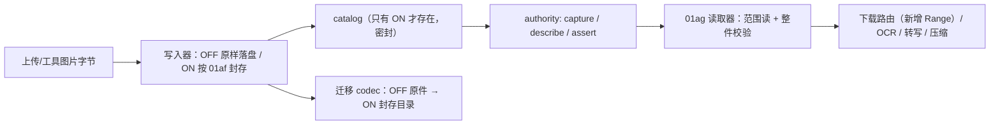

# 107 · M3 附件存储设计（2026-11-05）

本片只出设计，不改产品代码。目标是把 106 登记的两个 required 面（`uploads-attachment`、`uploads-tool-image`）
从「原始字节 + pending adapter」推进到可实施的加密方案，并明确 **OFF 行为、运行时读路径、迁移映射、失败语义与验收门**。
版本仍 **3.0.1**，M3 未完成、未发布。

## 1. 现状（代码事实）

- 写入：`04-permission-runtime.js:10` `makeAttachmentRecord` 用普通 `writeFile` 落 `uploads/<id>/<name>`（`id = file_<16hex>`）；
  工具图片由 `10-context-governance.js:690` 写 `uploads/toolimg_[<sessionTag>_]<sha1-24>/<name>`（临时文件 + rename，
  目标已存在则跳过）。
- 读取：`13-http-router.js:1388-1406` 的下载路由只有 token 门、basename 校验、词法 `pathWithinRoot` + `realpath`
  双包含校验与整件 `readFile` 200；**目前没有 Range/206/416**。
- 清理：`02-session-store.js:2389-2400` 删会话只按 `toolimg_<tag>_` 前缀清工具图片；原始附件不自动清。
- 迁移：这两面目前没有 codec，整目录原样复制 —— 开启加密后会留下明文原件。
- `01ag` 的读取契约是 **精确** 的：`create({root,keys,authority})` 需要 `keys.snapshot` 与 authority 三件套
  `capture/describe/assert`；descriptor 固定 8 字段（`opaque,revision,manifestSha256,manifestBytes,generation,
  purpose,scopeId,recordId`，`opaque`/`revision` 为 32-hex，`purpose` 仅 `session|cache`）；盘上路径固定为
  `<root>/<opaque>/<revision>/manifest.json` 与 `part-NNNNNN.json`，census 只要求 `<revision>/` 目录名集合精确相等
  （不含 `<opaque>/` 与 `uploads/` 根）。

## 2. 目标形态

### 2.1 盘上布局

- **OFF（默认，未启用工作数据加密）**：布局与今天完全一致 —— `uploads/<id>/<name>` 原字节；
  `toolimg_...` 原图。升级后字节不变，**不创建 catalog、不加密、不迁移**。
- **ON（启用后）**：严格按 `01af`/`01ag` 的契约落在 `uploads/` 根下：
  - `uploads/<opaque32>/<revision32>/manifest.json`：加密 manifest（逻辑名、mime、kind、分块表、整件 sha256）；
  - `uploads/<opaque32>/<revision32>/part-000000.json`（`part-` + 6 位序数 + `.json`）：加密分块（256 KiB 明文一块）；
  - `opaque` 由附件 id 派生（`sha256(id)` 前 32 hex），`revision` 为本次封存的 32-hex 版本号；两者都必须是**小写** hex；
  - `01ag` 的 census 只比对 `<revision>/` 目录里的名字集合（`manifest.json` + 各 `part-*.json`），
    **不**覆盖 `<opaque>/` 与 `uploads/` 根 —— 本设计不在那两个层级做额外断言；
  - 封存提交并校验整件后才删除对应的 `uploads/<id>/` 原始目录；任一步失败保留 `uncertain`，**不回退成明文读取**。
- catalog：按面拆成两个文件，避免「一个 sealed 文件只有一个 purpose/scopeId」的限制：
  - `uploads/_catalog-attachments-v1.json`：purpose `session`、scopeId `sessions`；
  - `uploads/_catalog-tool-images-v1.json`：purpose `cache`、scopeId `index-cache`；
  - 两者都用 `WorkDataStore.createText({chunked: true})`（catalog 行数会超过单条 `MAX_PLAINTEXT` 上限）；
    行字段 `{id, opaque, revision, kind, logicalName, mime, manifestSha256, manifestBytes, generation, state}`；
    `state` 只允许 `pending|sealed|uncertain`，`pending/uncertain` 不授权读取。
  - catalog 只在 ON 模式存在。OFF 时**由调用点直接跳过创建**（不能依赖 store：`createText` 在 OFF 下会写明文，
    `guardWrite` 还会先建目录），并用测试断言 OFF 不产生任何 catalog 文件。

### 2.2 读取

- 下载路由：**新增** Range 支持（206 + `Content-Range`，越界 416），命中时走 `01ag.readRange`；
  不带 Range 时整件读取并 `01ag.verifyWhole`（不是 01af 的 `verifyComplete`）。当前实现没有 Range，
  这是本设计新增的能力，须连带补测试。`01ag` 单次范围读默认上限 `maxReadBytes = 8 MiB`，超过返回 `read_limit`，
  该错误映射为 416（与越界同一客户端错误类），设计只承诺「单次 ≤8 MiB 的范围读」，不承诺任意大 Range。
- OCR/转写/压缩先 `verifyWhole` 再处理派生件；派生件仍走既有 `media-derived` sealed store。
- 任一环节 manifest/分块/哈希/身份不一致 → typed 错误，**不返回截断或旧副本**。

### 2.3 写入与删除

- 上传路由（仅 ON）：写 `pending` catalog 行 → 分块 + manifest → 整件校验 → 更新 `sealed` → 删原件。
  中断留下的 `pending` 目录读侧一律拒绝，并提供显式清理入口（不做后台自动删除）。
- 删除：ON 模式下 `toolimg_*` 的清理**先按 catalog 解析**；同时保留 `toolimg_<tag>_` 前缀兜底，
  用于清理迁移前遗留的明文目录。原始附件仍只由用户显式删除，本设计不新增自动清理。
- 同 id 去重与 `upload.bin` 回落名保持今天的语义（工具图片目标存在则跳过；非法文件名回落 `upload.bin`）。
- 重封存会产生新的 `revision` 目录；旧 revision 在 catalog 指向新版本且新版本整件校验通过后才允许删除，
  失败时保留旧版本（本稿把「旧 revision 清理时机」列为待评）。

### 2.4 迁移映射

- 新 codec 族 `uploads-attachment` 与 `uploads-tool-image`：
  - OFF → ON：每个文件按 `01af` 封存成 `<opaque>/<revision>/`，再写 catalog 行；整件校验后删原文件；
  - ON → OFF：解封回原文件名与字节，删除 manifest/分块目录**和 catalog 文件本身**
    （否则残留的 chunked catalog 会让下一次 OFF 写入被判 `downgrade_refused`）；
  - 只允许整目录原子切换；半态目录按 `uncertain` 处理。
- `send-derivative` 仍不登记（无生产者）。

## 3. 与既有约束的对应

| 约束 | 对应做法 |
|---|---|
| 86 §8.1 有界分块 + 认证清单 + 范围读 + 整件校验 | 严格复用 `01af` 分块/manifest 与 `01ag` range/verify，不改格式 |
| 不把“未支持”当完成 | adapter 在真实 NTFS 验收通过前保持 `pending` |
| OFF 零行为变化 | OFF 布局/字节/无 catalog；升级不迁移、不加密 |
| 失败不说成成功 | catalog `pending/uncertain` 不授权；错误 typed 且保留主错误 |
| Windows 一等目标 | 目录/文件身份、大小写、保留名由既有 Windows 形态工具处理 |
| 已有 `media-derived` 面 | 只做派生图片缓存，不替代原始附件；两者互不复用 |

## 4. 验收门（实施时逐项记录）

1. 单元：catalog 状态机（pending 拒绝读）、分块边界、范围读、整件校验、删除与半态；OFF 字节不变。
2. 真实 NTFS e2e：写入 → 进程被杀 → 重启后 `pending` 拒绝 → 显式清理；写入 → range 读 → 整件校验 →
   迁移 OFF→ON→OFF 后字节一致。
3. 迁移 e2e：带附件的会话在开关前后各跑一次，附件可下载、hash 相同，目录内无明文残留。
4. 静态门：清册/冻结表仍 80 面/47 required；adapter 只有在上面 1–3 全过后才从 `pending` 改 `wired`。

## 5. 已定与待评

已定（本稿按既有契约拍板）：

- 布局必须遵守 `01ag` 的 `<root>/<opaque 32hex>/<revision 32hex>/manifest.json|part-NNNNNN.json`，
  不能自定义 `manifest.bin` 之类后缀。
- purpose：原始附件 `session`，工具图片 `cache`，与 106 的清册/冻结表一致；因此 catalog 也按面拆成两个文件，
  各自绑定自己的 purpose/scopeId。
- catalog 只在 ON 模式存在；OFF 不写新文件（由调用点跳过，不依赖 store 的 OFF 明文行为）。
- catalog 使用 `chunked: true`：行数随附件增长，单条记录会超过 `MAX_PLAINTEXT`，chunked 是既有大记录通道。

仍待用户拍板：

1. 是否允许「删除会话时连带删除原始附件」（当前只删工具图片；本稿默认不扩权）。
2. 封存后是否保留原始目录作为可回滚副本；本稿默认**不保留**（整件校验通过即删，失败保留 uncertain）。
3. 重封存后旧 `revision` 目录的清理时机（立即删 / 下次成功封存后删 / 保留一代）。
