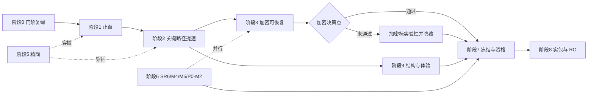

# 151 · 3.1 发布前优化与修复总计划（2026-11-18）

本文把 3.1.0 发布前必须完成的全部事项合成一张有先后、有通过标准的计划。它不替代各分项文档的细节与证据：体验、隐私、加密与精简的走查发现见 [150](150-3.1-experience-privacy-walkthrough-20261118.md)；原有发布门、原生验收与分工见 [149](149-3.1-release-execution.md)、[148 交接](148-3.1-checkpoint-handoff-20261118.md) 与 [需求审计](evidence/semantic-retrieval-20261116/3.1-remaining-requirements-audit-20261117.json)；语义检索方案与 SR1–SR8 见 [147](147-3.1-semantic-retrieval-and-recovery.md) 与 [发布门](evidence/semantic-retrieval-20261116/release-gates.json)。基线 `ce9b329d`，版本 3.0.1，3.1 未到 RC。

## 0. 一页结论

**3.1.0 = 修好体验与正确性 + 关闭原有发布门 + 冻结后实包验收。** 过去的验收几乎全部投在原生证明上，150 号走查发现用户实际感受到的问题（发消息慢、搜索结果不显示、失败后被锁死、隐私残片外发）没有被任何门拦住。所以本计划把 150 的修复放在原有发布门之前，并新增一组体验门；原有 SR/M 门的通过标准一条不降。

执行顺序（§3 有依赖图）：

1. **阶段 0 门禁复绿**：HEAD 的快速门本身不绿，先修，否则后续改动无从判断。
2. **阶段 1 止血**：泄露、整轮失败、锁死、功能不可见。
3. **阶段 2 关键路径提速**：拿掉发送前与检索里的重复回验。
4. **阶段 3 加密可恢复** 与 **阶段 4 结构与体验** 可并行；阶段 3 有一个**截止决策点**（§5）。
5. **阶段 5 精简** 穿插进行：第一批已审，前 5 项在做，其余随阶段 1–3 顺手合并。
6. **阶段 6 其他 3.1 必须项**：M4 媒体、M5 工作流、SR6 常驻生命周期等，与阶段 2–4 中互不依赖的部分并行。
7. **阶段 7 冻结与资格**：源码、模型、运行时冻结后一次性跑 SR2 独立盲测、千片段性能与全部消费者。
8. **阶段 8 实包与 RC**：重建 Slim/Full/Full-local，本机安装、升级、还原、回退与最终回归，独立复核后做 RC 决策。

不给发布日期或完成百分比（与 148 号一致）；§2 每项给的工作量是粗量级，用于排序，不是承诺。

## 1. 发布范围（已定）

| 类别 | 内容 | 依据 |
|---|---|---|
| 3.1.0 必须 | 本机离线产品与可验证的支持路径：P0/M2 文字隐私边界、M3 工作数据加密与索引生命周期、M4 媒体保护、M5 接力与定时模板（本机）、SR1–SR8 语义检索与压缩恢复、M6 新离线包；**加上 150 号的批 0–3 修复与本文阶段 0 的门禁复绿** | 86、149、150 |
| 移到 3.1.x | QQ/飞书真实平台联调；跨机安装、迁移与外部环境矩阵 | 149「3.1.x 接续」 |
| 延期（非 3.1 门） | 严格托管 CLI / 独立 namespace / VM；本地 ASR（不支持的原音频继续阻止外发） | 需求审计 scope_decisions |
| 取消 | M2-5 通用公网 HTTP 内容脱敏 | 86 |
| 条件收敛（用户 2026-11-18 拍板） | 阶段 3 未能在 3.1.0 前通过其标准时，工作数据加密标实验性并默认隐藏入口 | 150 §9.2 |
| 变体 | 按实际通过的变体做 RC 决策；涉及第三方分发的变体（Full-local）须先满足自身来源交付条件 | 149 |
| 语义默认 | 原默认不变；SR2 未过则新模型不注册为默认、对应消费路径不放行，自动注入保持 `automatic:null` | 147 |
| 精简（用户拍板） | 砍精简提案前 5 项；外部机器人（P6）、语音学词（P7）等暂不动 | 150 §9.4 |

## 2. 分阶段事项

状态：**已完成**＝已实现并经独立审查；**进行中**；**待做**。量级：S ≤1 天，M 2–4 天，L 1–2 周（粗估）。ID 指向 150 号的发现编号。

### 阶段 0 · 门禁复绿（先做）

| 事项 | 改法 | 通过标准 | 量级 | 状态 |
|---|---|---|---|---|
| 研究控制器单测 | 根因：9 个 `semantic-resident-*` 夹具把 `process.env` 展开成普通对象（`{...process.env}`）交给 vm，丢了 Windows 环境变量名不分大小写；从 Git Bash（MSYS 把变量名转成大写 `SYSTEMROOT`）启动时 `process.env.SystemRoot` 为 undefined，11 项红，从 PowerShell 启动 116/116 过。不是产品或研究逻辑缺陷。修法：夹具展开后补回规范大小写的 `SystemRoot`/`WINDIR` | Git Bash 与 PowerShell 下均 116/116 | S | 已改，待审 |
| copy-path-guard | 白名单登记的 SSE 正则词表行因 ce9b329d 前插 5 行而位移 1722 → 1727（与 1b94cfc6 逐字节相同，全文件仅一处） | 该锁 ALL PASS | S | 已改，待审 |
| steward-config、thread-brief 两件静态红 | steward-config（06h/06ha/06hb 相对 06i 的顺序）、thread-brief（搜索结果 briefTitle/briefGist）；分别与精简 P5（删 01u，改 manifest）、P2（删 13d 旧搜索索引）重叠，**等前 5 项合入后再做** | 100 件静态全过 | S | 待做（排在精简合入后） |
| 墙钟敏感单测 | 三件根因都是测试窗口而非产品缺陷：U3 冷回合起手在负载下超过 1500 ms 超时（改为先标定一次普通回合耗时 W0，批准窗口 = 回合超时 = clamp(3·W0, 1500, 12000)，慢回合对照改为「工作台掐断连接」的因果判据）；semantic-bridge 截止被遵守，超出的是回收后 PowerShell 观测进程的 0.75–0.9 s（改为分别断言回收开始时刻与扣除观测后的回复时长）；semantic-budget-progress 是 Windows 计时器 15.6 ms 粒度吃掉 31 ms 余量（改为虚拟时钟，真计时器一用即抛）。三件均在修复前代码上反向验证仍红 | 4 路并发 3 轮这三件 0 红（已达） | S | 已改，待审 |
| 阶段 0 审查的留待项 | 量具 worker 意外早退时子孙进程核不到（在 XG_PARTIAL 时先取树快照）；G-first 会执行 PATH 上真实的 claude/kimi `--version`（收窄 PATH 或注明例外）；批量卡「开→再关→不带 override」路径补测 | 各项补测或注明 | S | 待做 |
| 测试残留落进仓库 | `unit/observation-ref-vault-persistence.test.js` 在仓库 `output/` 下建临时目录且不清理；跑全量单测时仓库根会生成 `Microsoft/`（某个单测以缺 LOCALAPPDATA 的封闭环境起 powershell.exe），具体件待定位 | 全量单测后仓库根与 output/ 无新增 | S | 待做 |
| 新发现的负载偶发件 | `semantic-source-integrity.test.js:7` 在第 3 轮（更重负载）红 1 次、单跑 3/3 过，同样用真 `Date` 加载 06ha；按「跨轮重现即缺陷」再观察一轮，复现即按同法改 | 4 路并发 3 轮 0 红 | S | 待做 |
| 负载偶发件（2026-11-19 阶段 2 期间） | `privacy-failure.browser` 在整机满载时两次红、断言不同（一次 synthetic getUserMedia not held，一次 classic「actual warmup was not held」），基线与改后在低负载下各 2/2 过；`work-data-maintenance-runtime`「restore successor…」满载偶发 null job（1E 已把测试预算改墙钟，基线 1/36 复现）；`provider-turn-failure-surface` T11 基线同负载 1/4 红；`fulltext-metadata-admission` 已在 2C 改虚拟钟；`session-head-read` ④ 用墙钟断言「<60 ms」，4 个阶段 3 代理并行时实测 75 ms（应改为数重试次数）；`journal-work-data` 收尾 rmSync 偶发 EPERM（Windows 临时目录锁）；G-search-first-screen 在 4 代理并行负载下 p95 827 ms（低负载 257 ms）。按「跨轮重现即缺陷」逐件取证 | 4 路并发满载 3 轮 0 红 | S | 待做 |
| 2A 审查留待项 | `memoryStatIsRacy` 对未来时间戳（时钟回拨、拷入文件）永远判在窗口内，每次整读算摘要（只是性能）；令牌里用量账、取代边、目录 stat 无粒度窗口（进程外同刻同尺寸改写理论可漏，进程内写由世代兜住）；gemma2 后端显式检索仍只看前 64 头 | 未来时间戳设上限或记一次告警；剩余风险写入说明 | S | 待做 |
| 3E 审查留待项 | 无样本时伪造包仍可凭 instanceId 通过（已另存旧头，可考虑显式确认开关）；分块 workData:3 记录与嵌套目录不进样本，manifest 根缺头且全是分块记录时无路可走；legacy 根无头有密封记录时启动不拒、ensure 会新造密钥（3E 前即有）；凭据库探测无重试，瞬时超时被当锁住；口令输入为 GBK/无 BOM UTF-16/PS5.1 管道时只给通用错误（建议检测 U+FFFD/NUL 给提示）；助手超时时启动最多多等约 34 s | 各项补齐或注明 | S | 待做 |
| 加密规模实测结论（3C 两轮审查） | 原生普查约 1.1 ms/项，启用要做多遍普查，10 万文件撞原生命令 120 s 超时（且超时码未类型化）；字节预算 120 MiB 计入整个根（含各代与旧明文根），密封约膨胀 1.37×，启用一次后再导出/停用只剩约 50 MB 明文余量；包格式整包在内存。按 150 §9 拍板「加密批 2 未完成则标实验性隐藏」：除非 3D（常驻 broker/只传哈希/超时解耦）与流式包格式在 3.1.0 前落地并让 10 万文件、1 GB 合成根通过，否则 3.1.0 的工作数据加密标「实验性」并默认隐藏入口 | 3D 后复测；不达则落实「实验性隐藏」并写进发行说明 | M | 已落实「实验性、默认隐藏」（3H）：3D 实测 10 文件根启用约 40–47 s（达标），1 万文件每步 19–40 分钟、10 万文件未跑完（快照阶段 source_changed）、1 GB 被 120 MiB 普查预算类型化拒绝、流式包格式未实现，**不达**大根标准。新增配置键 `workDataEncryptionExperimentalV1`（默认关，只认 JSON true，管家 forbidden），开关在「设置 → 高级 → 实验性功能」并写明限制；面板只在后台状态（13ah 当场读 config.json 原文）报明文且开关已开时提供「启用加密」，关着时后端以 `work_data_setup.experimental_disabled`（409）在目录探测与维护闸之前拒绝新的启用、不改数据；已加密根的转明文/导出/恢复、进行中的作业与恢复提示、doctor/rewrap 等 CLI 恢复手段一律不受开关影响。README、CHANGELOG 已写明实验性与已知限制 |
| 3A 审查留待项 | 演练残留清理按目录名 + 所有权判定、未记录创建身份（篡改 claim 或预置同名目录可误删，场景牵强）；doctor 超时被停时其原生助手可能短暂存活（由 idle_win32 重试兜住，需确认 stdin 关闭即退出）；cold-failure e2e 偶发「claim 停在 committed、冷端在 owned 前退出」未复现到根因（01g/13av 只按 PID 判活的假说未证实）；桌面壳延长启动窗口未做 GUI 实机 | 创建时把演练目录 dev:ino 写进 claim；复现或证伪偶发红 | S | 待做 |
| work-data-production-restore.e2e 反复偶发红（跨轮重现=缺陷） | 04b31495 基线 2/2 红（后继超 120 s）、3A 合入后 1 次红在 plain-preference-2「normal serve exited before ready」——但该 serve（同 PID、同创建时间）实际在监听并写了 runtime.json，ChildProcess 却报 close；单跑与随后两轮 2/2 绿 | 取证 close 事件与真实存活矛盾的机制（夹具进程管理/句柄/CIM），修夹具或产品 | S | 待做 |
| 卡死的单测（3C 二审发现） | `pretender-index-incremental.test.js` 在 worktree 的 run-all --fast 里挂住超过 90 分钟（主树全量单测此前未见）；按「跨轮重现即缺陷」取证 | 复现或证伪并修 | S | 待做 |
| 语义运行时负载下一次超时即冷却 | 06hb `stop('timeout')` 照旧 `markFaulted`：负载下单次编码超时就杀 worker 并进 30 s 冷却，期间搜索/预检都报「语义检索暂不可用」（rail S6 在 2F 合并时实测撞到）。超时与崩溃应分开：超时只丢本批，连续超时才冷却 | 满载下 rail/记忆件不再因单次超时进「不可用」 | S | 待做 |
| 4A 合入后 400 会话索引变慢、左栏搜索负载下等不到老会话 | 配对实测 G-search-index 37.2/25.3 s 对基线 19.6/20.1 s（仍 ≤60 s）；同一轮满载全量里 `rail-session-search.browser` 的 S1/S2/S4 红一次（20 s 内索引只到 75/222，老会话未进结果），单跑与基线各 1/1 过；`turn-start-latency.test.js` [C4]/[S3]、`memory-semantic.e2e` 同轮各红一次、单跑过。按「跨轮重现即缺陷」：再红就按缺陷取证；索引吞吐回落要在安静机器上配对重测并定位（让路节奏或持久化写入） **跨轮重现**：`turn-start-latency.test.js` [C4] 在 3H 合入的全量单测（2026-11-20，整机同时在删 27 个 worktree）里再红一次（断言「不为刚有答案的桌面条目再等起动窗口」，实测超出），单跑 3/3 过；3D 实现者另报该件在 run-all 里挂住 80 分钟以上一次。已不是噪声，按缺陷取证（先看 C4 的时间阈值是否只在负载下越界，以及挂住时停在哪条子测） | 待做 |
| i18n.e2e 冷启动首发 `/api/status` 贴着 3 s 超时 | 3G 审查配对 18×2：基线红 3、3G 树红 2，全部是 `request timeout`；冷启动后首发 `/api/status` 中位 2.1–2.2 s、最慢 3.3 s，超过该件写死的 3000 ms。既有问题，不是 3G 引入。要么查首发为什么约 2 s，要么按负载放宽该件预算（不降产品标准） | 待做 |
| 3G 审查留待项 | 「确认时改发当前 authority」变异黑盒钉不住（authority 一变确认段即收起，读状态期间按钮禁用），出计划时的 authority 只算纵深防御；英文单复数（「1 files」）未处理；工作数据区底栏仍显示「保存隐私设置」（U13 余项） | 待做 |
| 3D 审查留待项 | 13u 单条原生命令总上限约 2.94 h 只有推算依据，需用 scale-bench 在 1 万文件上记录单条命令最大耗时佐证；10 万文件需进一步减少整根普查次数（checkSource、publish 段）与每项原生开销；访问时间漂移导致的 source_changed；13am job.reason 未带类型化 timeout 详情；verifyBackup 仍多次整包读取 | 待做 |
| 体验门量具 | `dev-harness/experience-gates.js` 及 `lib/experience-gates-{run,worker,codes}.js`（测量工具，非 e2e，不进 run-all 与 facts 计数）：21 个已实现门 2 个达标、7 个未实现；基线见 §4.3；`process-safety` 的 killOwnTree 计数 368→369 已登记 | 量具可重复运行，基线存 `evidence/experience-gates-baseline-20261118.json` | M | 已实现，待审 |
| 主树检出卫生 | 根因：本仓 `core.autocrlf=true`，部分工具把 CRLF/混合行尾写进工作区，`git status` 按归一后比较显示干净。21 个文件已按索引重新检出（内容与索引逐字一致），eol-policy 全过。仓库根 `Microsoft/` 是 PowerShell ModuleAnalysisCache（某次探针环境缺 LOCALAPPDATA、cwd 为仓库根），本会话开始前已存在，产品源码无此类调用，来源未查明；按 148 先例加入 `.gitignore`，未删除 | eol-policy 过 | S | 已改，待审 |

### 阶段 1 · 止血（150 批 0）

| 事项 | 150 ID | 通过标准 | 量级 | 状态 |
|---|---|---|---|---|
| 新建记忆默认不进核心（单条弹窗、批量提议卡、后端兜底） | U13 | 新单测在旧代码上 3/5 红、新代码 5/5；S4b/S4e/E3b/A2d/A8d 更新，相关 e2e 与单测复验通过 | S | 已提交（8150e9b8） |
| 标题/摘要/最近请求先投影后截断；列表与会话头走显示还原 | P1、P6 | 60 字边界上的身份证/邮箱/密钥在管家输入中 0 残片；侧栏无 `[[RUYI_PVT` | M | 已实现（1B2 v2）：G-privacy-trunc 270→0；起名还原后管家认不出的值换类别词；存量标签读时重算与出口兜底；两轮审查 |
| URL 密码取最后一个 `@`；补 PGP/PuTTY/Azure/mysql -p | P2、P3 | 新语料全受保护，原 542 项不回归 | S | 已实现（1B1 v2）：WHATWG 扫描与 v5 正则并集（只增不减）；首轮审查阻塞项已修 |
| 短学习值：最短长度、常用词黑名单、词边界、协议键名不参与；迁移清理已落盘短映射 | P4 | `token: on` 场景能正常对话；旧数据升级后线程可用 | M | 已实现（1B1 v2，da030839）：占位值跳过、短值就地保护但不学成全局规则、ASCII 词边界、协议键与 role/type/name 不参与；旧短映射加载时撤出学习、仍可还原 |
| 语义失败降级：启动失败不永久化、非守卫异常回退关键词；会话全文搜索同样降级 | S1 | worker 起不来时对话照常、回执标「语义不可用」；非 preview 线程搜索不再 500、索引照常建（体验门基线：命中记忆的回合 2/6 到达 provider，非 preview 搜索 0/3 全 500）；资产修好后无需重启即恢复 | S | 已实现（1A）：`SemanticFailurePolicy` 只让守卫类异常上抛，其余回退关键词基线并标 `semantic.status:'unavailable'`；全文搜索同样降级；可用性失败不永久化，冷却 30 s 起倍增、封顶 5 min，热身通过不算稳定（审查后补：真实编码成功且存活满 60 s 才清零）；消息尾标与隐藏回执各有「语义不可用」文案 |
| 预检不自伤：usage 写入挪到回验后；stale 时保留已校验的核心记忆 | S10、S11 | 核心超席位场景本轮不丢记忆 | S | 已实现（1A）：usage 写入挪到回验之后；stale 分会话级（照旧空结果）与数据级（按当前库关语义重算一次、标 `recovered:'stale'`、不重复发失配通知）；尾标显示「基础结果」 |
| 搜索结果全部画出、超时不清空、连续超时退避并露出「继续搜索」 | U1、U2、U11 | 后端回 N 条左栏画 N 条；超时保留已有结果 | M | 已实现（1C）：G-search-drawn-ratio 0.16→1；审查后只认源级超时、按需建卡加 LRU。`rail-session-search.browser` 的 S1/S2/S4 在 HEAD 基线同样红（索引每请求只推进 16 个会话，阶段 2 S6），留作阶段 2 验收 |
| 错误文案与维护期界面：补 `work_data_*`、`work_data_key.*`、隐私缺失码；聊天错误按码走文案；读 `processRestartRequired`；维护页；维护期禁用输入 | W10、U3、P10、U12 | 走查脚本里所有失败面都是人话；locale 锁覆盖新码 | M | 已实现（1D）：G-codes 146→0；审查后修正「人话前缀 + 内嵌 JSON」被误吞 |
| 记忆摘要露出为助手消息尾标；测试断言可见性 | U4 | 用户可见；e2e 断言元素可见而非读隐藏节点 | S | 已实现（1D） |
| 1D 审查留待项 | 维护页按 Accept-Language 先显示对应语言；管家壳输入框 `#stewardComposerInput` 接维护闸门；桌面关闭时 13ag `accepting()` 抛 `maintenance_busy` 文案不符；`preparation_failed` 由后端带上真实原因（W10 子项）；记忆尾标重载/切语言后重画（需把 memoryCheck 落在消息上）；CSS 载荷锁注释区历史条目整理 | 各项补齐或注明 | S | 已实现（1E，65a2ee4e）：六项全做；另把记忆尾标落在助手消息上（越过尾随 stderr 行）、桌面关闭独立稳定码 `desktop_lifetime.closing`（让位维护交接时仍说维护）、`preparation_failed` 带白名单原因；两轮审查。未做：维护页不显示具体原因（维持「页面不含码」）、13ah 热端 `worker_failed` 不带原因 |
| `steward_missions` 结果包 foreignView | P8 | 管家能看到事项，不再整份扣下 | S | 已实现（1B1 v2，da030839） |

### 阶段 2 · 关键路径提速（150 批 1）

| 事项 | 150 ID | 通过标准 | 量级 | 状态 |
|---|---|---|---|---|
| 记忆预检 check 改为快照令牌比较；显式检索同改 | S2、S12、S16 | 1000 条记忆预检 ≤300 ms；回合内全量读注册表 ≤1 次；撤权用例照过 | M | 已实现（2A）：快照令牌（进程内写世代 + 目录/取代边/用量/配置 stat）+ 披露条目逐文件 stat + 加密时比钥匙，每批编码前只 stat 本批；粒度窗口内的文件按内容摘要比；显式检索同改并在期限内连续翻页。1000 条预检约 0.6–1.5 s（重排全超时）→ 75–110 ms（重排成功），读注册表 4–6 次 → 1 次；显式检索找最旧目标 11 次调用/9.7 s → 1 次/0.19 s；两轮对抗审查（首轮修「加密开关关时封印头从缓存出明文」） |
| 加密记忆头缓存（stat + authority）与有界并发 stat | S3 | 加密 200 条预检 ≤500 ms | S | 已实现（2A）：封印头按 size+mtime+ctime/ino+当前钥匙 authority 缓存（与开关无关），8 路有界并发；加密 200 条预检约 5–6 s → 50–100 ms；G-send/encrypted/N=200 p95 约 2.6–2.9 s → 0.4 s |
| 只在 descriptor ready 时重排；loading 标签修正 | S12、S18 | 冷模型期每回合不额外等 250 ms | S | 已实现（2A，loading 标签在 1A）：descriptor 未 ready 时直接交基线并后台预热（遵守 1A 冷却退避） |
| 能力矩阵、桥接 MCP 目录先用旧值后台刷新；provider 回合不等 CLI 探测 | S4、S17 | 开机首条 ≤2 s（不含模型本身）；锚点不应答不卡 3 s | M | 已实现（2B）：provider 回合能力矩阵与桥接 MCP 目录先用旧值后台刷新、冷启动只等 150 ms 给临时矩阵（只少不多）；按会话冻结能力快照 60 s（从探测时刻起算），临时→完整只升级一次（拍板：宁可一次前缀缓存断裂，也不让联网/git/桌面工具藏 60 s；P2 改为稳态比对并新增「至多一次变化」确定性断言）；ACC 慢启动记「启动中」而非缺席；provider 回合读配置不等 CLI 探测（S17）。开机首条（/health 一通即发）5.1–7.7 s → 0.5–0.7 s；锚点不应答 6.3–6.5 s → 0.5–0.7 s；MCP 挂住约 1.9 s（保留首回合 1.5 s 窗口让新配置的 MCP 首回合可用，未达 ≤250 ms 额外等待，系拍板取舍）；顺带修测试会拉起真 ACC 的夹具（agent-wake-w3 等） |
| 发送前独立步骤并行 | — | 200 条记忆热态 ≤400 ms | M | 已实现（2B）：无副作用的读同拍起跑、预检留原位（有副作用）、错误顺序不变；200 条记忆热态低负载 p95 约 140–220 ms |
| 全文检索 `cap.assert` O(1)；check 从逐窗提到逐行；每次 score 只做首尾两次权威回验 | S6、S8 | 编码吞吐接近无守卫（≈50 片/s）；160 会话稳态搜索 ≤1 s | M | 达标（2C + 2F）：2F 把每次权威 select 的 lstat/realpath 从 8 次降到 5 次（文件级 realpath 覆盖数据根链路）、索引目录链 6→4、逐来源 I/O 改宽度 8 的有界有序窗口（复核点数量不变）；低负载 160 会话稳态中位数 1.0–1.3 s → 0.62–0.72 s（单发最大约 0.8 s），满载下仍会超 1 s。2C：cap.assert 按写计数器 O(1)、check 提到逐行、建索引改时间片（每发至少 16 个、1.5 s 片、上限 256）、语义回验两档；160 会话满载配对（CPU 94–99%）稳态搜索 16.1→3.7 s（语义开）/4.4→1.58 s（语义关），编码约无守卫的 70%，未达 ≤1 s 与 ≈50 片/s；审查后撤回 final 收窄（它会让管家相关线程标题绕过权威复核），出口仍逐来源复核 epoch。rail-session-search.browser S1/S2/S4 转绿（满载下仍偶发） |
| 编码预算估计用往返计时 | S9 | 4 条批不再被拒 | S | 已实现（2C）：worker 不回 workerEncodeMs 时用往返计时；4 条批占比 0.29→0.95，编码超时 5→0 |
| 剩余预算不够一片时不再解析下一批来源；超时回复不等 PowerShell 观测 | 阶段 0 测试走查附带发现（同 S8、S13 一类） | 单次 score 不超过自身截止；worker 卡死时检索回复不被观测拖后约 0.8 s | S | 已实现（2C）：下一批解析前判剩余预算；超时先 stop 再回话，OS 观测不再拖住回复；截止后不丢已核批次（S13） |
| canonical 切片快速路径 + 差分锁 + 按 contentRevision 缓存 | S5 | 100 KB 中文 ≤100 ms，事件循环最大间隙 ≤50 ms；FORMAT3 逐字节一致 | M | 已实现（2D）：单码元快速路径（规范化稳定的白名单单码元，按字素断点性质证明两两必断），两份副本逐块相同并有锁；FORMAT3 与修前逐字节一致（约 50 万码元差分 + 审查方 560 万字模糊，0 差异）；切片缓存按正文、字节记账（两份合计 ≤64 MB）、删除/暂停/维护/策略变化即清、清空世代防回填、unref 定时清扫；建索引每 16 ms 让出。10 万中文字切片 1.8–2.8 s → 29–58 ms；建索引事件循环最大间隙 1.5 s → 约 30–40 ms。G-bigtext 整门仍约 90 ms，余量在 2B 的启动探测 spawn 同步段与搜索回包投影，不在切片 |
| 关键词先回、语义后补 | — | 关键词首屏 ≤500 ms | S | 达标（2C + 2F）：G-search-first-screen p95 257 ms（低负载），160 会话预览 0.36–0.39 s；满载未复测。2C：词法预览按候选顺序回读够即停（提前停时 partial:true），建索引期间语义标 deferred；满载下 G-search-first-screen p50 约 0.9–1.2 s（低负载一轮 p95 488 ms），未稳定达 ≤500 ms，余量卡在两次权威复核的会话头读（02 owned() 每次约 12 次 fs 调用），留阶段 2 收尾 |
| 历史投影按内容哈希 + scope revision + 策略签名缓存 | P14 | 1 MB 历史重复请求的投影 ≤100 ms | M | 已实现（2E）：请求槽（messages/input）与宿主历史行按 scope 身份 + revision + 策略签名 + epoch + 检测选项摘要 + pointer + 内容指纹缓存，命中时复核到期、按槽重放预算（学习值索引建造费只收一次）、克隆返回；revision 变化/连接关闭/scope 替换即释放，内存估算按存下的投影算、为真实上界；1 MB 重复历史投影约 1.2–1.8 s → 23–40 ms，输出逐字节一致；两轮对抗审查、26 个变体全被打红 |

阶段 2 的数字须在 4 路并发负载下另跑一遍：150 §0 已证明固定 250/1000 ms 预算在负载下被回验吃光、产品退化为纯关键词。

### 阶段 3 · 加密可恢复与可扩展（150 批 2 + 149 的 M3 剩余）

| 事项 | 来源 | 通过标准 | 量级 | 状态 |
|---|---|---|---|---|
| 冷进程失败不 `hold()`：未写 intent 且源未改时自清理、放弃 claim、回原根；提交前预检文件系统 | 150 W1、W8 | 注入 verify-backup 失败后服务自动回到可用，无需 CLI | M | 已实现（3A）：未写 intent 且源未改时按本次创建身份自清理演练目录与备份包、复核源权威后放弃 claim、由恢复型后继回原根（作业按原号可读 failed+recovered）；提交前与冷端快照前探测备份卷与数据根父目录（exFAT/FAT32/ReFS/网络、盘符根直下的数据目录直接拒绝并给指引）；注入 verify-backup/flush 失败后服务自动回到可用。两轮审查 |
| 启动拒绝自愈：已发布只差收尾自动收尾；owned 无 intent 自动 source recovery；其余写 last-start-error 与人话指引 | 150 W5；149 r48 普通停用偶发 | r48 型场景重启后自愈 | M | 已实现（3A）：普通 serve 先只读预检，intent/handoff 待收尾时起与隐藏 doctor 相同的子进程自动收尾，只重试会自行消失的原因，整次收尾 300 s 上限、单次子进程有界；桌面壳认到固定标记延长启动窗口到 360 s 并显示「正在自动收尾」（C# 已编译、静态锁钉住，未做 GUI 实机）；W5 只差收尾复核的元数据漂移改为完整重新资格审查；last-start-error 刻意不写（维护拒绝不写入数据根），改 stderr 稳定码 + 桌面弹窗 |
| status/readResult 与备份包解耦；可预期失败不进 retain；交接期 status 不进 operation | 150 W2、W9 | 移走备份包后面板可用、可再导出；交接 20 轮 0 次 uncertain | M | 已实现（3B）：status 用只做记录校验、只 lstat 备份包的 observe（present/missing/changed/unavailable），不再因备份包被移走 503，可再导出；交接期 status 不进 operation/inflight（W9 根因：已核验的 readResult 横跨退休边界 → handoff_not_retired → uncertain），交接 20/20、100/100 轮 0 uncertain；可预期失败不进 retain、retain 后不再给陈旧缓存与下载；备份目录被换成 junction 判 changed；具体 work_data_result.* 码透传并有人话 |
| 演练移到数据根同卷私有临时目录，失败清理 | 150 W7 | 备份目录里不出现明文 | S | 已实现（3A）：演练改到数据根同级 `.ruyi-work-data-rehearsal-<id>`，成败都按身份清理；崩溃/被杀残留在恢复主人证明原进程死亡后清掉，并对模型文件工具隐藏；备份目录在演练各阶段扫描未见明文 |
| 流式普查与打包，去掉 1 万项/96 MB 整根上限；排除日志/缓存/worktree；预估规模；`.corrupt`/`.tmp` 盘点与移出隔离区；旧明文与旧代清理 | 150 W3、W4、W13 | 10 万文件、1 GB 合成根可启用；带 `.corrupt` 的根给出可操作提示 | L | 部分达标（3C）：去掉 1 万项/96 MB 整根硬上限，改为统一预算（20 万条目/各 10 万文件与目录/120 MiB），所有超预算路径（含 C# broker、MaxJsonLength）端到端给类型化 limit 与人话（多大、哪些区域、怎么办）；包与新代排除可再生缓存、agent-worktrees 等（普查与证明仍覆盖全部对象），退休代与旧明文根在无技能备份时不进包；产品自己的 .corrupt/.tmp/撕裂日志尾行不再让操作失败（审计日志迁移已提交前缀），旧明文根里的残留可报告并隔离（同根 rename、带清单与撤销、不删除）；删除式旧代清理按审查砍掉（无逐文件来源证明会误删）。**未达**：10 万文件撞原生 120 s 超时（→3D），1 GB 受整包在内存与 120 MiB 预算所限；inspect/隔离已接到设置面板（3G：只读体检与预计结论、移入前逐个列清单并确认、可撤销，持维护闸并与作业/上传接收/桌面关闭互斥，按数据根串行，绑 authority；未知错误归一不带路径；同批收 U13 归 3A 的四条 P3 文案与 3C 审查 S6 措辞；三轮审查）。三轮审查 |
| 性能：常驻 broker 或预编译替代逐次 `Add-Type`；合并 flush；普查只传哈希；演练与 verifier 合并；超时与 uncertain 解耦 | 150 W11、W12 | 10 文件根启用 ≤60 s | L | 部分达标（3D）：10 文件根启用 99.6 s → 46.8 s（同负载配对；轻负载 70.7–74.6 s → 40.2 s），达标 ≤60 s。做法：01ad 旧明文根转换整轮一次捕获（prepare 阶段整根原生普查 53 → 7 次，与行数无关）、01ab seal 整根复核 3 → 1 次、只为复核的普查只回哈希、刷盘助手在冷操作驻留期内常驻（首次 829 ms、之后 7–8 ms，驻留期外仍一次一进程）、原生 broker/校验子进程/冷进程握手改为「多久没有进展」计时并各有总上限、超时码类型化（native_timeout，不含路径）、原生助手 cwd 固定为 System32。**未达**：1 万文件每步 19–40 分钟；99,000 文件在快照阶段报 source_changed（疑为 NTFS 延迟写回访问时间，同 149 r8）；1 GB 仍被 120 MiB 普查预算拒绝；流式包格式只有设计草案、未实现；演练与 verifier 未合并。三轮审查 |
| 恢复包重新包裹密钥（DPAPI 损坏/换机） | 150 W6 | 翻转密钥头后可用恢复包恢复 | M | 已实现（3E）：启动按密钥头六态判定（重试成功记 healthy、读失败记 unavailable 不挡启动、真锁/损坏/缺失才拒绝并给 CLI 指引）；`work-data-rewrap-key` CLI 用恢复包经 AEAD 样本证明（认证通过须多于失败）后以当前用户 DPAPI 重包工作数据密钥、凭据库与外部机器人凭据，全有或全无、逐字节回滚，证明不干净时另存旧头；口令只走隐藏输入/管道/文件（去 BOM、识别 UTF-16），argv 拒绝；并发持根时拒绝；侧存与临时件不进模型文件工具。两轮审查 |
| 二次确认、draining 显示阻塞者并设上限 | 150 W14 | — | S | 已实现（3B）：启用加密二次确认（初始焦点在「返回修改」，按住 Enter 不会误启用）；draining 上限 120 s，显示阻塞者种类与数量，超限 drain_timeout 并给指引 |
| 冷读即重写加密全文索引 state | 精简第二批审查发现（基线即有）：新起的运行时只做冷读与搜索，就把 `sessions/_fulltext-index-v1/state.json` 重写（大小不变、revision 变化），`derived-index-work-data.e2e` 在 `unchangedCurrent` 处红 | 只读路径不写盘；该 e2e 全过 | S | 已实现（3F-1）：根因是 prepare/step 每次无条件写 state(building/idle)、加密档每写必重封；改为盘上 phase 真变才写，building 惰性写在第一次真改动之前，载体与当前策略不符时按未知走旧路径（加密档明文照重封、关闭档密封照拒），维护窗口进出作废已知 phase；derived-index-work-data.e2e 全过；两轮审查 |
| 隐私外发清册存量漂移 | `docs/architecture/privacy-egress-inventory` 已落后：现算 385 文件 / 937 候选 / 437 条待复核，提交版是 310/768/102 | 单独一刀刷新并逐条复核，不混进其他提交 | M | 已实现（3F-2）：全量刷新到 387 源 / 948 候选、`--check` 0 errors，新增与变更候选逐条归类（AUDIT 3F 节）；修清点器两处漏：C# 逐字字符串让词法失步而藏掉 RuyiDesktop.cs 的真边界（NavigateToString/Navigate/Process.Start 等现已入册）、P/Invoke CreateProcess 起进程纳入枚举；过时断言改钉 13af startRelay#write。未发现应过隐私网关却直连外发的产品路径 |
| M3 完整生命周期：同一冻结候选与新数据根上启用、导出、验证、停用、删除，再验恢复、崩溃恢复、ADS、上传、portable；非空技能用例收尾 | 149 1A、需求审计 M3-enable-restore、M3-index-lifecycle | 每阶段原始结果与进程退出；r46 型主流程连续通过，停用不再偶发要求恢复 | L | 进行中（r46 主流程通过；r48 停用偶发、非空收尾超时） |

### 阶段 4 · 结构与体验（150 批 3）

| 事项 | 150 ID | 通过标准 | 量级 | 状态 |
|---|---|---|---|---|
| 后台增量建索引与编码、向量持久化（加密同样加密）、删除只清本会话向量、大文本可续做与跳过标记 | S6、S7、S14、S15 | 首次搜索只付词法成本；重启不需暖机；400 会话后台建完 ≤60 s；1 MB 消息不挡后续会话 | L | 已实现（4A，含 U5）：后台增量建索引与编码、向量持久化（加密开启时同样加密）、删除只清本会话向量、大文本可续做并留跳过标记；左栏命中方式小标（关键词/语义/两者，U5）。2026-11-20 与 4B 提交配对实测（整机有别的批在跑）：G-search-first-screen p95 434/297 ms 对基线 371/541 ms，G-search-drawn-ratio 1，G-search-index 400 会话 37.2/25.3 s 对基线 19.6/20.1 s（达标 ≤60 s，但比基线慢，见下方留待项）。四轮审查 |
| 隐私剩余：坏代号只替换片段（P5）、导出降级（P7）、正则排队与按规模预算与零宽校验（P9）、误报漏报（P12、P13，银行卡复用 `luhn`）、凭据库失败分类与可恢复（P15）、不可用时显示与 busy（P16）、P11、P17 | P5–P17 | 各项语料与 e2e | L | 已实现（4B）：P5 坏代号只替换片段、P7 明文导出降级、P9 正则排队/按规模预算/保存时零宽探测、P11 本线程导出显示类别、P12/P13 规则目录 v7（数量语境、银行账号、一次零宽/全角归一、luhn+卡组织前缀+业务号上下文、IPv6），语料正例 340/340 完整覆盖、反例 0/230 误报（v6：318/7），v6→v7 差分锁（含类别）0 丢失；P15 凭据库失败分类与绑定变化时暂扣（绝不交给变更后的端点、暂扣随条目退役、进备份）；P16 策略待确认标记与保存等回合；P17 变体代号显示还原、机器人回帖不截半个代号、ruleOverrides 配置键。三轮审查 |
| 体验：短查询语义噪声与命中方式标记（U5）、起标题不与主回合争抢且去重复调用（U6）、记忆面板接语义或注明范围（U7）、首屏 CLS（U8）、隐私开启后文件树理由（U9）、合并两个语义开关并显示模型状态（U10）、P3 级文案（U13） | U5–U13 | CLS ≤0.1；其余按项验收 | M | 大部分已实现（4C，U5 归 4A）：U6 起标题挪到首回合结束后、让路后续回合、只在端点不应答时重试（单槽端点首条请求 p50 约 820 ms → 40–67 ms，每线程一次起名调用）；U8 首屏 CLS 0.47–0.55 → 0.028（门槛 ≤0.1，首访失败也会撤闸）；U7 记忆面板按卡片所示字面匹配并注明范围（未接语义：无记忆检索路由，避免绕开召回的隐私与来源复核）；U9 文件树在隐私开启时说明原因；U10 两个语义开关合一并显示模型状态（只读 /api/status，按访问有界）；U13 若干 P3 文案。未做：390 px 左栏只剩色点（需设计决定）、locale-en-us 夹具里其他模块运行时写入的 16 处中文、3A/4B 范围内的文案项。两轮审查 |

### 阶段 5 · 代码精简

| 事项 | 通过标准 | 量级 | 状态 |
|---|---|---|---|
| 第一批：零调用死代码（src −259、public −9、dev-harness −113），worktree `simplify/3.1-batch1` | 独立审查结论「可提交」，无阻塞 | — | 已合入（`0aa09851`，与前 5 项一起） |
| 前 5 项中的 P2、P3、P5、P12 及第一批审查的 2 条建议 | 实现者在仓库外副本完成并验证（单测改后红与基线逐条相同、静态 96/100、相关 e2e 过或与基线同红）；以相对 `ce9b329d` 的全量补丁交付（含第一批，74 个文件 +1637/−3000，`git apply --check` 通过），因实现 agent 无权写第二个 worktree，待用户同意后由主会话套入 `simplify/3.1-batch2`，再做第二次独立审查 | L | 已套入 worktree；第二次独立审查「修改后可提交」，已按意见处理（隐私外发清册两份 docs 退回基线、只留 manifest 与 AUDIT.md，避免把 102→437 的存量漂移混进精简提交；修陈旧注释；CHANGELOG 补用户可见的设置删除；清掉测试残留），已合入（`0aa09851`） |
| P1 技能备份胶囊降级 | 分批实施（实施记录见 §8.9–8.13）。胶囊只在加密开启时启用，且作为 `skill-backup-portable` 特殊覆盖项接进整个数据根的备份、恢复与迁移流水线（01ab、01ad、01t、13aj、13ak、13aq、13au、13am、01x 九个受保护模块，dev-harness 约 55 个文件）。方案：加密开启时只保留已含完整名字与字节的加密档，删 C# 助手、broker 与 objects 容器，撤销时由加密档重建（内容逐字节一致，不再保留安全描述符与读时间）；回收站不能用，否则是明文旁路。升级兼容：3.0.1/3.0.2 没有胶囊，升级用户只有明文目录备份，现有 rename 撤销照旧；胶囊只可能出现在开过加密的 3.1 开发版或预览版上，新实现读同一份加密档即可撤销。**并入阶段 3 一起做**（同一批受保护模块要为 W1/W3/W4 重写），约省 src 4000 行 | L | 按 §8.13 收口：新备份和正式模式切换使用加密档，旧预览版兼容路径和整根数据共用的 Windows 后端保留 |
| 随阶段 1–3 合并：P8 逐字重复、P9 回验链（即阶段 2 的 check 改造）、P10 先登记研究策略再删一套 provider、P15 replanBaseline、P11/P13 | 随所属阶段验收 | M | 待做 |
| P14 研究证据归档：`dev-harness/semantic/` 935 个文件打包为带 SHA 清单的归档、CI 不再加载 | 冻结证据 SHA 可追溯 | M | 已实现（5-P14，三轮审查）：按 `d5d3caff` 的 git 对象把研究目录 934 个文件与只测它们的 19 件研究测试（12 件常驻控制器单测、原生宿主原型的 unit 与 e2e、4 件校准实验单测、冷操作研究单测）打成 `dev-harness/archive/semantic-research-d5d3caff.tar.gz`（ustar+gzip，953 个文件），清单逐文件记字节数、sha256 与 git blob 号，清单与包的 sha256 另记校验和文件；`research-archive.js` 零依赖核对、解包、与源提交逐字节比对、从 git 对象重建（重建逐字节相同）；Windows 自带 tar.exe 与本工具解出的 953 个文件均与 `d5d3caff` 逐字节相同。盲测相关的 15 个文件（v7 两件与 `.rgignore` 声明的 acceptance*）及 `.rgignore` 留在原处、只按名字登记；只依赖产品文件的两份语义运行时维护脚本（refresh-license-lock、download-candidates）也留在原处，semantic-runtime 文档照旧指向它们。原 semantic-calibration 里守产品 06ha 的断言原样迁到 `semantic-production-admission.test.js`；`unit/research-archive.test.js` 钉冻结身份、清单与包一致、默认回归与 CI 不再触及研究目录。unit 571→555 件、e2e 661→660 件 |

合入策略：两批精简与阶段 1 的主树修复都触及 server.js 拼接产物，并行分支合入时冲突集中在产物与生成物上；合入顺序为「第一批 → 前 5 项 → 阶段 1」，每次合入后重拼 server.js、重算生成物、跑快速门，不并行合多条分支。

### 阶段 6 · 其他 3.1 必须项（与阶段 2–4 中互不依赖的部分并行）

| 事项 | 当前状态（149/148） | 剩余与通过标准 | 量级 |
|---|---|---|---|
| SR6 常驻语义运行时与宿主生命周期 | 控制台宿主正常关闭与两次移交组件路径通过；EmbeddingGemma 2 常驻 65 s 闲置、禁用、重启、正常关闭限定通过；真实模型下控制台宿主正常关闭、突然终止通过进程回收（§8.14），维护恢复移交通过模型回收与后继预热（§8.15），双实例共用模型配置时各自回收（§8.16）；生产 Node CLI（§8.17）和打包 `Ruyi.exe`（§8.18）均验证优雅退场与 Ctrl+C，强制终止和关闭 Windows 伪终端也通过原进程回收（§8.19）；独立 CLI N-API 原语已编译并做受控加载 | 完整桌面异常退出与可见双实例已验（§8.23）。外层 Job 允许嵌套、外层配额拒绝创建均已验（§8.25）。待验：成功导出后的真实模型移交、创建后拒绝分配内层 Job、异常退出后的私有目录清理；全部 legacy/direct Node/fallback 的 unknown 围栏；整机资源 | L |
| M5 工作流（本机） | 接力 25、嵌套接力 12、定时模板 29 条断言通过；本地 group 4 + human 9 业务与严格进程验收通过 | 本机回环的超时、冷重启、重复回调与单次副作用见 §8.22。真实平台在 3.1.x | M |
| M4 媒体（本机） | 历史 Full-local 本地包与受保护图片/PDF 回环通过（限其输入） | 当前冻结树与新包重验支持的图片、文档、视频的实际外发字节与失败路径 | M |
| M4 公开分发（Full-local） | OpenH264 头文件与许可证补件可复建；FFmpeg 构建对应关系与重链接缺证据 | 上游构建证明、源码交付、重链接与法律复核；**外部依赖**，关不了则 Full-local 不进 3.1.0（按 149 变体规则） | L，外部 |
| P0/M2 最终回归 | 历史批次已关，限其冻结输入 | 当前冻结树上授权的非排除回归与交叉复核（含隐私变更、取消、撤权、恢复） | M |

### 阶段 7 · 冻结与资格（依赖阶段 1–4 完成）

源码、模型、运行时与方法冻结后再测，阶段 2–4 的性能与行为改动会改变这些结果，提前测没有意义。

| 门 | 通过标准（不降） |
|---|---|
| SR1 模型与运行时来源 | 新离线包内模型、tokenizer、CPU runtime 的来源、许可与 notices 可追溯 |
| SR2 质量与性能 | ≥1000 片段；warm 编码 p95 ≤150 ms、含来源与隐私检查的完整搜索 p95 ≤500 ms；中文 Recall@5 ≥90%，中英双向各 ≥85%，MRR ≥0.75，无答案误召回 ≤5% 且无答案样本 ≥40；独立未暴露 V7R3 只在冻结后一次性运行（用户已裁定此前误发的 grep 不算暴露） |
| SR3 检索消费者 | HTTP/UI/Agent/管家各入口真实模型端到端；来源、隐私、版本边界与部分覆盖如实 |
| SR4 同会话压缩恢复 | 两次压缩后命中可重读正确原文；跨引擎边界 |
| SR5 记忆召回 | 显式检索真实模型回归；自动路径仍只重排、`automatic:null` |
| SR6 | 见阶段 6 |
| 体验门 | §4.2 全部达标 |

### 阶段 8 · 实包与 RC

| 事项 | 通过标准 |
|---|---|
| 重建 Slim / Full / Full-local 的最终 EXE 与 ZIP | 归档包 SHA；包内服务与冻结源码逐字节一致 |
| 本机安装、升级、还原、回退、低资源与重启演练 | 同一包哈希下全部通过；离线 |
| SR7 新离线包、SR8 最终树回归与独立验收 | 授权回归首轮与复验原始记录；独立复核 |
| RC 决策 | 发行负责人逐项核 §4 清单，按实际通过的变体决定版本号与 RC；发行说明如实标注 3.1.x 接续项与已知限制 |

## 3. 依赖与关键路径

关键路径是 阶段 0 → 1 → 2 → 4（后台索引与向量持久化）→ 7（SR2 千片段与盲测）→ 8。阶段 3 与阶段 6 的 SR6 是另外两条长链，最好与阶段 2 同时开工；阶段 6 的 M4 公开分发受外部事实约束，可能决定 Full-local 是否进 3.1.0。

## 4. 3.1.0 发布判据

### 4.1 原有门（不降）

SR1–SR8 全部 pass；M3 完整生命周期（或按 §5 决策点降级为实验性隐藏）；M4 本机媒体与（若交付 Full-local）公开分发材料；M5 本机接力与定时模板；P0/M2 最终回归；M6 新包安装、升级、还原、回退。

### 4.2 新增体验门（本文新增，阶段 0 建量具）

| 门 | 标准 |
|---|---|
| 发消息到请求发出（provider 引擎，热态） | 0 条记忆 ≤100 ms；200 条 ≤400 ms；1000 条 ≤600 ms；加密 200 条 ≤800 ms |
| 开机首条消息（不含模型本身） | ≤2 s；任一 MCP 未就绪或网络锚点不应答不增加等待 |
| 线程搜索 | 关键词首屏 ≤500 ms；后端命中 N 条则左栏画 N 条；超时不清空已有结果；400 会话后台索引 ≤60 s |
| 大文本 | 1 MB 中文消息不阻塞事件循环超过 50 ms；不挡其他会话建索引 |
| 失败面 | 所有已知失败码有中英文案，界面不出现原始码或 JSON；语义运行时不可用时对话照常 |
| 加密失败 | 任何一步失败后无需隐藏 CLI 即可回到可用状态；备份目录不留明文 |
| 隐私 | 截断边界语料 0 残片外发；短学习值不致整轮失败 |
| 负载 | 4 路并发下语义相关 e2e 连续 3 轮通过 |

### 4.3 当前基线（阶段 0 量具）

量具 `node dev-harness/experience-gates.js [--quick] [--enforce] [--out f.json] [--only …]`：默认只测量、exit 0，`--enforce` 时已实现的门不达标即 exit 1；完整模式约 6 分钟，`--quick` 约 3 分钟。基线 2026-11-18，`ce9b329d` 加未提交改动，Node 24.14；机器负载 59–90%，同期另有一轮 4 路回归，绝对毫秒偏大；本检出未装语义运行时资产，「语义开」实为「开关开、运行时 failed」。证据 [experience-gates-baseline-20261118.json](evidence/experience-gates-baseline-20261118.json)。

| 门 | 当前基线 | 标准 | 达标 |
|---|---|---|---|
| 发消息到请求发出 · 0 条记忆 | 语义开 p50 197 / p95 232 ms；语义关 p50 222 / p95 344 ms | ≤100 ms | ✗ |
| 同上 · 200 条 | 语义关 p50 334 / p95 413 ms；语义开（budget）p50 342 / p95 368 ms | ≤400 ms | 关 ✗ / 开 ✓ |
| 同上 · 1000 条 | 语义开 p50 1075 / p95 1228 ms；语义关 p50 944 / p95 1275 ms | ≤600 ms | ✗ |
| 同上 · 加密 200 条 | p50 4849 / p95 4920 ms（n=3，盘上已核封印） | ≤800 ms | ✗ |
| 开机首条 | 无故障 p50 7.1 s（最大 8.1 s）；锚点不应答 10.7 s（多 3.6 s，缓存过期后再多 3.0 s）；MCP 未就绪 7.6 s（此后每条多 2.6 s） | ≤2 s 且不增加等待 | ✗ |
| 线程搜索 · 关键词首屏 | 200 会话 p50 1007 / p95 1205 ms；只在正文里的词首屏 0 条 | ≤500 ms | ✗ |
| 线程搜索 · 命中 N 画 N | 4/25 = 0.16（`?sessionIds=` 对较早线程返回 0 行） | =1 | ✗ |
| 线程搜索 · 400 会话后台索引 | 90 s 未建完（97 s 时 240/400，语义关；语义运行时 failed 时非 preview 搜索直接 500） | ≤60 s | ✗ |
| 大文本 1 MiB | 事件循环最大阻塞 1798 ms（p99 277 ms）；其他 30 条会话都能建索引 | ≤50 ms；不挡其他 | ✗ / ✓ |
| 失败面 · 失败码文案 | 缺码专属文案 146 个（HTTP 必达 102 + 隐私网关与恢复 44；另有 109 个未证实可达界面的码另列） | 0 | ✗ |
| 失败面 · 语义不可用时对话照常 | 回合到达 2/6（命中记忆的回合全部整轮失败）；非 preview 搜索 0/3（500） | 100% | ✗ |
| 隐私 · 截断边界残片 | 先截再识别 270 个（标题 60、摘要 160、最近请求 240 三处）；先识别再截 0 个 | 0 | ✗ |
| 搜索超时不清空、界面无原始码、加密失败自救与备份无明文、短学习值、4 路 3 轮 | 未实现（需浏览器或单件超出量具预算），实现思路记在量具头注 | — | — |

## 5. 决策点与风险

| 项 | 规则 / 需要的决定 |
|---|---|
| 加密范围截止点 | 用户已拍板：阶段 3 未能在 3.1.0 前通过其标准，加密标实验性并默认隐藏入口。建议在阶段 2 完成时评估阶段 3 剩余量，届时定截止 |
| SR2 不过 | 按 147 规则：新模型不注册为默认，对应消费路径不放行，原默认不变，自动注入保持关闭；不调已消耗集合、不降门槛 |
| Full-local 外部依赖 | 按 149 变体规则：来源交付条件关不了就不交付该变体，Slim/Full 单独 RC |
| 回归基线漂移 | 阶段 0 之前任何「红件与基线相同」的结论都要同环境对照；阶段 0 之后以全绿为基线 |
| 精简与修复的合并冲突 | 阶段 5 合入顺序固定（§2 阶段 5），每次合入后整条生成器链重跑 |

## 6. 执行规则

- 每个实现点：实现者提交差异与回归入口，**独立 agent code review**（CLAUDE.md 规定），修复后再审；主会话亲自核对审查结论与原始结果，子 agent 报告不直接当证据。
- 行为变更带 e2e；改了既有断言的，逐条列出被改断言与理由（CONTRIBUTING 第 5 条）。
- server.js 相关的重活在主树串行做；并行 agent 只做只读走查、测量或独立 worktree 里的精简，合入按 §2 阶段 5 的顺序。
- 测试与服务一律隔离 HOME/USERPROFILE/APPDATA/LOCALAPPDATA/TEMP；只收自己起的进程；不碰盲测材料；不跑可见桌面与已排除的四项 GUI 场景。
- 提交与推送只在用户明示时进行；本文与 150 号的状态以每批交付后的更新为准。

## 7. 截至本文的进展（2026-11-18）

| 事项 | 状态 |
|---|---|
| 150 号六线走查与主会话复核 | 完成；四个共同根因与分批方案见 150 |
| 用户拍板四条（盲测不算暴露、加密条件收敛、新建记忆默认核心是缺陷、砍精简前 5 项） | 已记入 150 §9 |
| 新建记忆默认不进核心（单条、批量、后端） | 已实现；单条弹窗部分经独立审查，批量卡与后端部分按审查意见补改并复验通过；未提交 |
| 精简第一批 | 已实现、独立审查「可提交」；未提交 |
| 精简前 5 项 | 进行中 |
| 阶段 0–4、6–8 其余事项 | 待做 |

## 8. 交接（2026-11-20，用户要求本波做完即暂停）

分支 `codex/3.1-completion-plan`，已推送到 origin。续做先 `git log --oneline 04b31495..HEAD` 核对，再读本节与上面各阶段表里标「待做」的行。

### 8.1 本轮（2026-11-19 至 11-20）已提交的批

| 批 | 提交 | 审查 |
|---|---|---|
| 3F 冷读不写 state.json；隐私外发清册与扫描器两处修 | `3b3e1a6d`、`1337ef8e` | 两轮 |
| 3B 状态不依赖备份包 | `ba9ff769` | 两轮 |
| 3E 用恢复包重包工作数据密钥 | `45aed447` | 两轮 |
| 3C 普查规模、类型化上限、崩溃残留 | `0da9f389` | 三轮 |
| 4C 首屏、起名、设置、文件树 | `8c34fdac` | 两轮 |
| 3A 冷操作失败后自行恢复 | `c703b201` | 两轮 |
| 4B 隐私识别目录 v7 与其余隐私项 | `2358676c` | 三轮 |
| 4A 后台增量索引与向量持久化 | `d5d3caff` | 四轮 |
| 3G 数据根体检与残留隔离接到设置面板 | `1d8bc358` | 三轮 |
| 5-P14 研究证据归档 | `eaecabb3` | 三轮 |
| 3D 加密性能与按进展计时 | `060244ad` | 三轮 |
| 3H 加密标实验性、默认隐藏 | `c15ad3b8` | 两轮（第二轮「可以提交」后改文案数字） |

### 8.2 阶段状态

- 阶段 0、1：完成。
- 阶段 2：实现完成。EmbeddingGemma 2 热缓存负载达到 1 s 目标，候选四路 E2E 仍为 11/12，剩一项语义误召回（见 §8.8）。
- 阶段 3：收尾。规模标准（10 万文件、1 GB）未达，按用户拍板走「实验性、默认隐藏」（3H，见第 53 行）。流式包格式、进一步减少整根普查次数、访问时间漂移导致的 source_changed 留作 3.1.x。
- 阶段 4：完成（4A/4B/4C）。
- 阶段 5：第一批与前 5 项已合入（`0aa09851`）；P14 已合入；**P1 技能备份胶囊降级按 §8.13 口径收口**；「随阶段 1–3 合并」那行（P8–P13、P15）未逐项核销。
- 阶段 6：SR6 已开始。真实模型在 Windows 控制台宿主下的两种退出场景通过（§8.14），维护恢复移交通过（§8.15），双实例退出隔离通过（§8.16）。生产 Node CLI（§8.17）与打包 `Ruyi.exe`（§8.18）的优雅退出、Ctrl+C、强制终止及关闭 Windows 伪终端后的进程回收均通过（§8.19）。M5 本机超时和冷重启重放已复测（§8.22）。M4 媒体与 Full-local 公开分发、P0/M2 最终回归待验收。
- 阶段 7–8（冻结与资格 SR1–SR5、体验门全达标、实包与 RC）：**未开始**；依赖阶段 6。

### 8.3 下一步建议顺序

1. P1 按 §8.13 收口。H2b 保留失败，阶段 7 复核语义误召回。第 49–61 行的偶发件继续按「跨轮重现即缺陷」逐件取证。
2. SR6 完整桌面程序异常退出和可见双实例见 §8.23。外层 Job 的嵌套与配额证据见 §8.25。创建后分配内层 Job 遭拒和异常退出后私有目录的处理仍待验。成功导出后的真实模型移交待验。M5、M4 和 P0/M2 可并行。Full-local 的 FFmpeg 构建证明仍是外部依赖，按 149 变体规则处理。
3. 阶段 7 冻结后一次性跑 SR2（含未暴露的 V7R3，盲测保管人是外部依赖），再阶段 8 实包与 RC。

### 8.4 工作方式（沿用）

- 每批：实现 agent 在独立 worktree 出相对固定基线的补丁 → 独立对抗审查 → 修复轮直到「可以提交」 → 主会话 `git -c core.longpaths=true apply --3way` 套入主树、重拼 server.js、重算生成物（route-inventory、module-dependency-graph `--write`、durable-state-inventory 与 encrypted-storage-freeze 用 `--write`、facts）、改 README 计数 → 全部 static、全量单测（`--test-concurrency=2`）、相关 e2e、相关体验门 → 提交并推送。
- 合并坑：README 冲突不能整文件取 ours（会丢掉对方批新增的段落），先看两边差异；KILL_OWNERS 两边各 +1 要相加；CSS 载荷锁按 `read-frontend-css.js` 流程合并后统一重钉；补丁里带 CRLF 的新文件要转 LF 再暂存，`-text` 的归档文件要从实现 worktree 原样拷字节。
- 审查与实现 agent 的报告不直接当证据：主会话亲自核对关键结论与原始输出。

### 8.5 本轮清理

- 已删：本轮 27 个批次 worktree（`.claude/worktrees/agent-*` 与 `simplify-batch2`、上一会话 scratchpad 的 `basewt`）及其 56 个已合入或只指向 master 的本地分支；删除前每个 worktree 的未提交差异另存为补丁（`%TEMP%\ruyi-151-worktree-backups\`）。
- 已停：3B worktree 遗留的 `work-data-successor` 进程（PID 27268，核对命令行后按 PID 停）；PID 17004 早已退出。
- 已删：测试与审查的隔离目录（`C:\rv3h`、`C:\r3a`、`%TEMP%\r3d`、`r3h`、`p14`）与仓库根的 `Microsoft/` 测试残留；`%TEMP%` 下全部 `ruyi-*` 测试夹具（2300 余个，只留 `ruyi-151-worktree-backups`）。
- 未动：`C:\r31-*`、`C:\r302-*`、`C:\r303-release`、`%USERPROFILE%\.codex\worktrees\*` 等其它工作的 worktree，仓库根的 `output/`（含夹具）与 `runtime/`。

### 8.6 阶段 2 四路负载复测（续做，2026-11-20）

- 基线 `5ec62e3b`，Windows / Node 24.14.1。修复前的三轮专项回归中，第二轮左栏浏览器 S6 首跑失败、重跑通过。回包已报告索引完成且语义模型在加载，左栏续查期间仍显示「正在准备搜索索引」。补齐真实模型后又复现已完成索引、语义片段部分可用时的同一问题。修复后，确认索引完成后按实际状态显示模型加载或语义覆盖进度，关键词预览和整次超时重试仍有原有提示。S15/S16 挂住第二发请求，逐字验证加载和进度文案。S6 随应用消费 JSON 正文登记回包，回包和 DOM 在一次采样中读取。
- `semantic-failure-degrade` 的 S1/S10 用虚拟时钟精确验证退避边界，子进程启动、退出和 I/O 走真实夹具。`turn-start-latency` 的 C4 用挂起扫描验证桌面条目落定时先拿旧目录，同一配置新增普通 MCP 时则等待新目录。注入 90 ms／325 ms 调度停顿可分别打红旧 S1／C4，新断言通过。禁用退避、取消倍增、禁用桌面目录复用、忽略普通 MCP 的 key 四个变体仍被对应断言打红。历史 C4 是否有同步进程启动本身超过 300 ms，仍待现场证实。
- 未装模型时，模型加载文案修后四路专项回归首跑三轮均 12/12 通过。覆盖左栏、会话搜索与后台索引、语义检索和不可用回退、记忆召回与预检。三轮 CPU 平均 41.9%／51.4%／26.6%，峰值 76.1%／92.8%／78.2%。静态通道 100/100。基线与最初修订的全量单测各 6104 过、4 红、29 跳过，同样四个 Windows 原生用例底层报 `metadata_changed`。因此用临时启动脚本单独运行现有 runner 的四路 E2E 和静态编排，保留逐件首跑和重跑结果。
- 体验门复测中，200 会话关键词首屏 p95 为 229.7／257.1 ms（门槛 500 ms），400 会话索引为 18.38／22.73 s（门槛 60 s）。大文本事件循环最长间隙为 98.8／77.1 ms（门槛 50 ms），其余 30 个会话全部可搜。200 条记忆热态语义关闭 p95 为 105.7 ms。
- 补齐本机模型资产后，默认 MiniLM 的锁定资产校验和真实 worker 单测 5/5 通过。同一模型的四路专项第二轮 S6 首跑复现语义片段进度文案问题，重跑通过，另两轮首跑通过。3.1 候选 EmbeddingGemma 2 文本 Q4 使用交接固定的 ONNX revision `daa72c51243991dfcaf9f9137d2c573d8f7790c0`、586 个 CPU 运行时文件和固定 Node 24.14.0，下载文件及重建档全部校验，模型指纹仍为 `sha256:9d41595d7508ff328b6c5a4223c7af26a91ed2fe53662cc9d633c1373eb4163e`。
- EmbeddingGemma 2 的真实生产运行时健康检查进入 `ready`，按 1／4 片一组编码 25 个合成片段成功，实得约 14.8 片/s，确认回收。160 会话合成库中，正文索引完成后同一查询连续测 8 次。启用候选模型时中位 1366.6 ms，8 次语义均超时，640 个候选片段缓存 0。关闭语义时中位 270.2 ms。候选当前走研究策略，后台不持久化其向量。三轮四路专项均为 11/12，`session-search.e2e` 的 B4、B5、G1、H2 在显式候选模式下首跑与重跑均失败。此处保留候选模式与旧全文搜索契约的差异，阶段 2 真模型性能门和候选兼容未通过。
- `privacy-failure.browser`、`work-data-maintenance-runtime`、`i18n` 本轮各首跑一次通过。`work-data-production-restore` 在明文恢复的 `plain-restore-successor` 阶段复现失败。旧服务正常退场、冷进程接管后约 3.4 s 开始报 `work_data_setup.restore_requires_inspection`，持续到 120 s 截止。已按进程创建时间核对并停止该夹具冷端，保留失败现场。这次失败早于历史 `plain-preference-2` 的异常，根因尚待定位。
- 独立复核覆盖语义退避、C4 桌面与普通 MCP 对照、左栏状态优先级及 S6/S15/S16 浏览器取证。采纳了 C4 保留桌面条目再新增普通 MCP、允许微任务让步、S6 随正文消费登记回包及保留关键词空预览提示。左栏浏览器用例在真实 MiniLM 和 EmbeddingGemma 2 上均通过。S15 在原基线失败，S16 在只修模型加载提示的版本失败，最终版本两者通过。

### 8.7 阶段 2 热缓存来源核验

- 对同一个 160 会话合成库延长预热并记录运行时计数。基线的缓存可以逐步增长，640 片全命中后打分耗时 9–25 ms。窗口策略随后串行回读 160 条会话约 0.6–0.8 s，叠加覆盖检查与来源回验后，仍持续撞上语义 1 s 截止。单次编码超时后的冷却是另一条已复现路径，首轮并发诊断中有一次 worker 被回收，后续回包暂时降级。
- 正文候选按会话分组，原文回读与权威回验复用现有 8 路有序读取器。每个来源仍核权限、epoch、revision、序号与附件。编码完成前后的序号检查和最终披露校验保留。独立复核通过，40 条定向单测、4 个搜索相关 E2E 全过。对新增并发断言换回原版源码，准确复现串行读取失败。
- 同一 160 会话、640 片段的热缓存实测，基线四次 1.35–1.65 s，均语义超时。修后预热 32 发，复测四次 500.6–548.6 ms，中位 508.2 ms，模型始终 ready、语义覆盖均为 complete。原文回读的实测跨度降至约 130–150 ms。整机 CPU 平均 15.9%。在显式启用 Gemma2 的四路 E2E 期间再测，热缓存四次为 750.6–789.4 ms，均覆盖 640/640，整机 CPU 平均 35.6%，峰值 72.1%。这两组达到阶段 2 的 1 s 热态目标，千片段 p95 ≤500 ms 仍待阶段 7 验收。
- 并行 E2E 为 11/12，`session-search.e2e` 仍稳定复现 B4、B5、G1、H2。当前阶段 2 的真模型回归还未收口。静态通道 100/100，构建产物与源码一致。

### 8.8 候选模型搜索回归诊断

- B4、B5 的首个回包为 `loading/partial`。同一夹具等到 `ready/complete`，多词和拼写漂移都命中目标来源，相似度分别为 0.81083 和 0.77475。候选模式的断言检查首个完整语义回包，仍要求命中。
- G1 的 `briefGist` 在候选模式为空，符合摘要字段独立准入。G2 直接搜该摘要独有词，确认完整 gist 随命中返回。默认模型仍验证原有的 `briefTitle` 和 `briefGist`。
- H2 词法预览完整且零命中。完整语义查询以 0.72746 错误召回同一会话的普通闲聊（`messageOrdinal=5`，`matchMode: semantic`）。H2b 保留无结果断言，误召回仍记失败。用户确认 P1 先推进。
- 候选模型四路专项三轮均为 11/12，首跑和重跑唯一失败断言均为 H2b。真实 MiniLM 的同件 E2E 通过，静态通道 100/100。本批只涉及回归和交接记录。

### 8.9 P1 明文目录备份兼容（2026-11-24）

- 明文技能更新发布失败时，仅回滚本次已成功移走的旧副本。回滚也失败时保留备份并返回结果不确定，禁止自动重试。撤销更新时若预期的备份目录缺失，保留当前技能和可重试的迁移记录，补回备份后可再次撤销。
- 本批迁移记录单测 28/28，迁移中心与迁移记录工作数据 E2E 均通过。P1 仍在进行，加密档重建、旧加密胶囊兼容和移除 objects / broker 留待后续。

### 8.10 P1 加密档重建验证（2026-11-24）

- 修正可移植恢复的内容回验，按精确相对路径和数据流名配对，核对已通过 SHA-256 校验的内容、大小和现有元数据约束。合法的数据流枚举顺序变化可以通过。
- 独立临时目录只复制旧胶囊的加密 archive 和 intent，清空密钥缓存后用新运行时解密，在新目录重建。真实 Windows / NTFS 用例检查全部路径，并逐字节复核默认流、文件和目录的附加流。基线同件在重建处失败，修后整件通过。相关单测 52/52。普通撤销和崩溃恢复仍走旧对象协议，下一批需接入新的对象身份和持久化恢复状态。

### 8.11 P1 加密档撤销与冷恢复（2026-11-24）

- 新建独立加密技能备份在加密意图记录中声明 archive-v1。撤销先校验当前技能，再在技能根下的私有暂存目录重建。发布前持久记录暂存目录、重建树和终态空容器的身份；重启后可据此辨认已经完成的移动。文件名、目录和数据流内容保持一致，重建会产生新的文件身份。
- 旧预览版有完整对象容器时仍按原身份恢复；独立备份只剩标记、加密档与加密意图时可以从档重建。部分损坏的对象集仍会报错。跨代绑定和加密开关转换继续走原协议。写入端仍创建 objects，C# 助手及 broker 仍被使用。
- Windows 实测覆盖正常撤销、发布前后中断、旧对象容器移走、部分清理和完成意图落盘失败。另起 Node 进程在发布后立即退出，第二个进程从磁盘接管。核对普通文件、文件和目录附加流、空目录、重复确认的文件身份；替换当前技能或新增待清理文件时拒绝继续并保留现场。相关单测 230/230，全部 100 件静态检查通过（交接文档混合换行已修正并单件复测）。

### 8.12 P1 加密档写入、整根备份与模式切换（2026-11-24）

- 加密技能更新写入标记、加密档和加密意图。发布前复核原树与新树，完成后清理已核对的旧树。故障注入覆盖移走旧树、发布新树和部分清理后重启。
- 整根导出和恢复支持没有 objects 的加密档，恢复后的数据根可以再次导出。真实 Windows 测试覆盖目录附加流、DPAPI 和另一个 Node 进程撤销。预览版只剩完整标记、加密档和意图时也可导出、恢复和转为明文。
- 加密转明文时在候选代重建备份目录。取消后验证原加密档逐字节不变；提交后验证明文内容，以及再次导出、恢复、再导出。迁移收据把新目录身份和原归档对应到同一修订。
- 切换为明文后，新撤销记录直接移动已验证的备份目录。Windows 业务撤销验证文件身份、只读属性、附加流和历史记录，冷启动后再次确认撤销结果。
- 明文转加密提交后移除已清空的旧对象。可取消阶段仍使用旧对象协议保留原身份；旧版中断记录和整根原生操作仍调用 C# 助手及 broker。P1 尚未全部核销。

### 8.13 P1 可取消的明文转加密迁移和 Windows 后端范围（2026-11-24）

- 本轮保留整根数据备份、恢复、目录持久化及 NTFS 句柄校验共用的 C# 后端和 broker。正式迁移入口在可取消阶段写入认证的加密档和迁移记录，不再拆分原目录、清空数据流或建立临时 objects。预览版胶囊和已经开始的旧格式事务保留兼容读取和恢复。
- 加密代提交前，原目录保留文件身份和内容；取消时恢复原位置。清单提交后，维护进程先持久记录清理阶段，再核对父目录、文件身份、名字和数据流，通过已绑定的 Windows 句柄移除原树，最后发布加密档。中断时，磁盘上可能仍有待清理的源文件，恢复验证通过后才能完成维护并开放新代。
- 测试覆盖保留身份的取消、移除部分文件后重启、第三方新增文件时停止并保留现场、只读文件与文件及目录附加流，以及提交后“整根导出 → 恢复 → 再导出”。

### 8.14 SR6 Windows 控制台宿主的真实模型退出

§8.14–8.19 记录专项分支 `0f629e51..c2a2ae83` 上的验证，各节计数属于当时的提交。

- 给现有桌面生命周期夹具增加 `--idle --semantic` 和 `--idle --semantic --owner-exit`。将 `RUYI_TEST_GEMMA2_ROOT` 设为已校验的 EmbeddingGemma 2 配置目录，再运行 `node dev-harness/desktop-lifetime.e2e.js` 并追加对应参数。夹具复制资产锁到独立目录，沿用生产资产校验和预热，核对 Windows Job 注册身份及实际启动的模型进程。
- Windows 实测正常关闭两轮各 12/12。原服务和模型进程均退出，生产关闭 ACK、管道与 Job 正常关闭，模型私有目录从 1 个降到 0 个。突然终止控制台宿主两轮各 6/6。两条输出流结束，原服务和模型进程均退出，遗留 1 个模型私有目录。
- 这批覆盖生产 `ServerHost` 的控制台夹具。桌面程序异常退出、带真实模型的维护移交、生产 CLI 生命周期及异常退出后目录清理仍待验收。原有合成 CLI 正常关闭 10/10、桌面生命周期与语义专项单测 52/52、静态通道 100/100 通过。构建和路由清册校验通过，独立复核通过。
- 全量单测按两路运行，6121 通过、4 失败、29 跳过。失败集中在原生目录元数据和冷转换普查，底层报 `work_data_backup.metadata_changed`。同四项在 P1 基线 `0f629e51` 上单独复跑也失败。

### 8.15 SR6 Windows 真实模型的维护恢复移交

- 在 §8.14 的 Windows 控制台夹具里用 `--idle --semantic --handoff` 提交实际导出作业。修复前，生产 `ServerHost` 已记录 `serve → cold → successor`，随后在原端口预热了后继模型。旧服务与冷进程均退出，旧模型进程从 Windows 进程表消失，但其私有目录仍在。
- 工作数据维护在作业提交之后、源服务退场之前等待现有语义运行时完成关闭。原模型退出无法确认或私有目录清理失败时，沿用维护设施的未确认处理。桌面窗口正常关闭继续按原顺序收尾。
- 修复后，Windows 真机连续三轮确认原服务、冷进程和旧模型进程退出，旧模型私有目录已移除。后继在原端口加载了独立进程中的 EmbeddingGemma 2，宿主正常关闭时新模型进程退出、私有目录清零、Job 排空。正常关闭和突然终止的原有真实模型回归通过，维护进程夹具、51 项定向单测、100 项静态检查和独立复核通过。
- 导出准备时报 `work_data_backup.metadata_changed`。后继按同一作业 ID 回报 `recovered: true`、`operationMayHaveExecuted: false`，工作数据权威未变。这批证据限生产恢复移交，导出成功后的真实模型移交待验。H2b 仍保留失败，留到阶段 7。
- 全量单测两路运行，6122 通过、4 失败、29 跳过。四项失败和 §8.14 的 Windows 原生元数据用例一致。

### 8.16 SR6 两个 Windows 控制台宿主共用真实模型配置

- 在 §8.14 的夹具里运行 `--idle --semantic --dual`，再追加 `--owner-exit` 复测突然终止。两个生产 `ServerHost` 使用同一份模型资产锁和两个独立数据根。实际服务分别监听 8765 和 8766，各有自己的 Job、注册进程、模型进程和私有目录。
- A 正常关闭时，原服务和模型进程退出，A 的目录移除。A 突然终止时，原服务和模型进程退出，A 的目录残留。两种情况下，A 退出后 B 的首次状态查询均为 `ready`，核对确认原服务和模型的进程创建身份、令牌及私有目录均一致。正常关闭 B 后，其 Job 排空、私有目录移除。突然终止场景最终仅剩 A 的目录。
- 该批覆盖控制台 `ServerHost`，完整桌面入口的互斥与 WebView 会话仍待验。单实例正常关闭和突然终止、生产维护恢复移交、合成 CLI 正常关闭回归通过，定向单测 44/44、静态通道 100/100、独立复核通过。全量单测 6122 通过、4 失败、29 跳过，四项和 §8.15 一致。成功导出后的真实模型移交仍待验。H2b 保留失败。

### 8.17 SR6 生产 Node CLI 的真实模型退出

- 将 `RUYI_TEST_GEMMA2_ROOT` 指向 §8.14 的已校验模型配置，运行 `node dev-harness/cli-semantic-lifetime.e2e.js`。两路都直接执行生产入口 `node app/server.js serve`，核对实际监听和进程身份，并等真实 EmbeddingGemma 2 进入 `ready`。
- 优雅关闭场景通过夹具的私有标准输入触发现有 `SIGTERM` 处理器。Windows 不提供外部 SIGTERM 送达，这一场景验证生产处理器。Ctrl+C 场景用独立的 Windows 伪终端输入 Ctrl+C，保留原 CLI 进程句柄。确认退出码为 0、原 CLI 和模型身份消失、模型的私有目录已清理之后才释放伪终端。[Node 信号说明](https://nodejs.org/docs/latest-v24.x/api/process.html#signal-events) · [Windows 伪终端说明](https://learn.microsoft.com/en-us/windows/console/creating-a-pseudoconsole-session)
- 本机两路各跑两轮，均观测到退出码 0、原进程退出和模型私有目录清零。Ctrl+C 的伪终端输出在释放时排空。既有桌面双实例回归、44 项定向单测、100 项静态检查和独立复核通过。全量单测 6122 通过、29 跳过、4 失败，四项和 §8.16 一致。打包 `Ruyi.exe`、突然终止和关闭终端仍待实测。H2b 继续保留失败。

### 8.18 SR6 打包 Ruyi.exe 的真实模型退出

- 在 `ruyi-workbench` 用锁定依赖执行 `npm ci`、`npm run build:exe`，再沿用 §8.17 的模型配置运行 `node dev-harness/cli-semantic-lifetime.e2e.js --pkg`。夹具复制新建的 `dist/Ruyi.exe`，按发行目录位置放置两个固定的语义模块，运行 `Ruyi.exe serve`。核对原始命令、进程身份、二进制 SHA-256，以及运行时 `launchMode: exe`、`isPkg: true` 和真实模型 `ready`。这批覆盖打包可执行文件及语义模块布局，完整离线安装包另验。
- 原打包产物的 Ctrl+C 首测通过。Windows 打包运行时忽略用来触发 SIGTERM 的预加载参数，所以优雅退场使用真实维护请求。修复前维护作业受理后报 `work_data_setup.worker_disconnected`。同一旧 EXE 的对照证实，打包器自启私有子命令时自动注入 `PKG_EXECPATH`，把命令误当本机脚本。冷维护、后继及验证器复用的启动函数显式传空值，恢复嵌入入口分派和原 IPC。
- 重建后两路各跑两轮，均在释放伪终端或收尾 Job 前确认原 CLI 退出码 0、原模型进程退出和原私有目录移除。两轮使用同一份重建 EXE，SHA-256 为 `9f8688b4fc76310e857f2029bff1728955db3d49a12ddce6d9d3976b97342672`。正常退场由已受理的维护作业触发，后续冷进程由夹具 Job 清场，导出及后继完整流程待验。Ctrl+C 使用真实伪终端输入。H2b 继续保留失败。
- 定向单测 102/102，新增断言在旧源码上打红。静态通道 100/100，维护进程夹具和真实模型桌面恢复移交复跑通过。裸 Node CLI 的优雅关闭首轮在预热状态查询时超时，单独复跑两路均通过。独立复核通过。
- 修复后全量单测按两路运行，6123 通过、29 跳过、4 失败，四项和 §8.17 的 Windows 原生元数据用例一致。

### 8.19 SR6 生产 CLI 与打包 Ruyi.exe 的异常退出

- 设置同一真实模型配置，运行 `node dev-harness/cli-semantic-lifetime.e2e.js --abnormal` 验证 Node CLI，再加 `--pkg` 验证当次新构建的 `Ruyi.exe`。两者均由私有 Windows 伪终端启动，先核对生产入口与原 CLI、模型进程的创建身份，再执行异常退出。
- 强制终止只通过原 CLI 的进程句柄调用 `TerminateProcess`，记录退出码 73。原模型进程在伪终端仍打开时已退出。关闭终端路径调用 `ClosePseudoConsole` 发送 Windows `CTRL_CLOSE_EVENT`，观察到原 CLI 退出码 `0xC000013A`，原模型进程也退出。两路均无夹具 Job 参与回收，取证范围是原 CLI 与模型身份。完整桌面窗口另验。[Windows 伪终端关闭](https://learn.microsoft.com/en-us/windows/console/closepseudoconsole)
- 两种入口的四个场景各复跑两轮，均观察到原 CLI 和模型进程退出，每次留有一个原模型私有目录，目录清理仍待验。首轮 Node 强制终止用例在动作前遇到状态查询超时，复测采用与桌面夹具一致的固定测试 CLI 路径。打包两轮的 EXE SHA-256 为 `d9cc4773a55a65b63c8e75b26de35854018b678403cdcfe8efe3cfa94cd7405a`。H2b 继续保留失败。
- 原有两种 CLI 入口的优雅退出、Ctrl+C 回归通过。定向单测 53/53、静态检查 100/100、独立复核通过。
- 全量首跑 6123 通过、29 跳过、5 失败。其中四项与 §8.18 的已知基线失败相同，另有 `session-artifacts-work-data.test.js` 在删除本次夹具目录时发生 `EPERM`。当前分支与上批基线各单独复跑该套件均为 19/19。

### 8.20 SR6 接入 11 月 24 日 P1 基线（2026-11-25）

- 集成基线为 `bc5ee425`。取 §8.14–8.19 的六个 SR6 专项提交，保留 §8.13 的备份实现，重建单体、模块图和路由清册。集成树新建的 Windows `Ruyi.exe` SHA-256 为 `94d2a1d5507bc84b75fb78ce1d7867d62e3d1c7c8c3fb28caacc5b788be8fc7c`。
- 首次维护移交在预热查询 `/api/status` 时触及夹具的 5 秒请求超时。改为在预热轮询原有的 30 秒总预算内等待本次响应。双实例对端的首次状态采样和维护请求保留 5 秒超时。复测确认后继在原端口加载新模型，旧模型进程和私有目录均已回收；导出准备仍报 `work_data_backup.metadata_changed`，后继按原作业 ID 回报恢复结果。
- Windows 真实 EmbeddingGemma 2 专项覆盖控制台宿主恢复移交、双实例正常和异常退出，以及 Node CLI 和当次打包 EXE 各自的优雅退出、Ctrl+C、强制终止和关闭伪终端。异常退出后原进程均回收，模型私有目录仍有残留。当前证据覆盖控制台宿主和 CLI，完整桌面窗口异常退出、可见双实例仍待验。
- 独立执行全部 100 件静态检查均通过；53 项定向单测通过，2 项跳过。构建新鲜度和 1644 个文件的语法检查通过。
- Windows 全量单测在默认并发和双并发下均为 6109 通过、11 失败、29 跳过。对照原始 `bc5ee425`，定向复跑这 11 项全部重现。失败涉及原生元数据、源目录清理、长路径归档撤销和历史源码对照。
- 加密技能备份 E2E 在归档重建处返回 `work_data_backup.portable_create_uncertain`。相同用例在原始 `bc5ee425` 同一步骤失败；集成树在 C 盘和 E 盘临时目录均复现，错误链包含 `captured_cleanup_uncertain` 和 `metadata_changed`。在隔离夹具内给三处元数据判据分别加诊断标签，重跑定位到 `VerifyCapturedBasicUnchanged`：仅上次访问时间不同。Windows 归档重建和成功导出后的模型移交仍待闭合。

### 8.21 SR6 预热请求截止时间（2026-11-25）

独立复核发现，§8.20 的 HTTP 请求按套接字空闲时间计时，持续收到分块时会接受迟到的就绪响应。新增回环回归在原实现上失败。现在请求从发起时计时，桌面和 CLI 两个入口都在接受就绪前核对总截止时间。修后相关单测 57/57，真实模型 Node CLI 的正常退出及 Ctrl+C 均通过。独立 agent 以相同的分块响应分别验证 70 毫秒预算超时、500 毫秒预算成功，复核通过。

### 8.22 M5 回复超时后的冷重启和重复回调（2026-11-25）

- 飞书本地模拟端收到真实工作台发出的回复后一直不回包，生产发送超时，业务记录显示任务已创建、投递结果未知。停止原服务，在相同数据根启动新服务，分别重放原事件与同一消息的新事件。两次均收到平台确认，随后等待同一连接的后一条命令完成。创建任务的工具回执、任务清单中的唯一会话 ID、业务与投递记录保持一致，模拟平台收到的目标回复共一次。
- 首次断言按模型输入标记选到了上一回合的工具回执。改为绑定当次创建任务的 tool_call_id 后，该用例通过，独立 agent 复核并重跑整件通过。原有飞书和 QQ 的进度及最终回复重放用例也通过。
- 本机复测线程接力 25 项、嵌套接力 12 项、定时模板 29 项；群决策和五类九项人工决策回环整件均通过。实测使用隔离数据根、模拟模型和本地平台传输；真实账号联调按 149 归入 3.1.x。

### 8.23 SR6 完整桌面程序的异常退出和可见双实例（2026-11-25）

- 在 Windows 设置 `RUYI_TEST_GEMMA2_ROOT` 后运行 `node dev-harness/desktop-lifetime.e2e.js --desktop-app --owner-exit`。双实例使用 `--desktop-app --dual`，追加 `--owner-exit` 验证 A 异常退出。各场景用生产构建脚本生成 RuyiDesktop.exe，启动正式入口；每个窗口使用独立工作数据和 WebView 配置，共用同一份已校验的模型资产。
- 在可见窗口中读取 UI Automation 文档，确认工作台页面连接到该实例的回环端口，并绑定桌面、服务、模型与 WebView 浏览器四个原始进程的创建身份。单实例强退后四个进程均退出。双实例中 A 正常关闭和强退两种情形均保留 B 的原窗口及进程身份，B 的首次模型状态采样为 ready。正常关闭清理私有模型目录；强退后 A 残留一个目录。
- 独立复核发现写回执持续报错会跳过失败清场。修复后，即使写盘失败或一个子进程终止抛错，仍逐个处理本次启动的桌面子进程，并保留首个错误。独立 agent 复核两项故障注入通过。集成树另在两个真实窗口就绪后持续注入 ENOSPC，确认原错误返回、两组共八个原始进程身份均已退出；三个正常验收场景也全部复跑通过。

### 8.24 P1 修复历史源码对照与打开权限矩阵（2026-11-25）

§8.20 的 11 个失败中有五个来自测试仍按 P1 之前的源码取值。更新权限矩阵后，48 种组合分别检查普通读取、暂存退役和已提交源目录清理时实际传给 Windows 打开操作的权限与共享掩码。新增逆变换先核对 P1 改动，再还原先前交给旧验证器的输入。独立 agent 从 Git 取出 `9a9cf068`，逐字节核对完整原生代码及表示测试，并用权限放宽、分派改变等反例验证测试确实拒绝。四个相关套件集成树复跑 40/40。

仍有 Windows 原生运行时失败。只在临时源码中加入时间字段观测，在目录共享测试中首次观测到父目录上次访问时间变化的位置是相对打开子项的元数据句柄后、设置该子项句柄的时间抑制之前。原实现中的元数据判据继续生效；此定位尚不能证明全部运行时失败都来自这一处。

### 8.25 SR6 外层 Windows Job 的嵌套和创建配额（2026-11-25）

- 运行 `node dev-harness/desktop-lifetime.e2e.js --idle --semantic --nested-job`。夹具将自身放入匿名外层 Job，生产宿主创建服务，将其分配到内层 Job。真实模型预热和正常关闭均通过。原始服务与模型退出，外层 Job 最终只剩夹具自身，私有模型目录已清理。
- 运行同一入口的 `--idle --outer-quota`，将外层活动进程配额设为 1。Windows 在 CreateProcess 返回 1816，未创建服务。独立复核发现仅凭错误码会误收管道创建前的错误。修后先保留 Win32 原错误，再记录失败调用的位置。独立 agent 复跑真实配额场景通过，在调用前注入同一错误码时验收失败；集成树的普通退出对照也通过。
- 创建成功后被拒绝分配到内层 Job 属于另一条错误路径，本轮未在本机复现。
