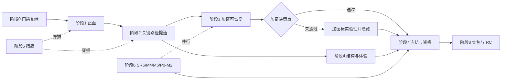

# 151 · 3.1 发布前优化与修复总计划（2026-11-18）

本文把 3.1.0 发布前必须完成的全部事项合成一张有先后、有通过标准的计划。它不替代各分项文档的细节与证据：体验、隐私、加密与精简的走查发现见 [150](150-3.1-experience-privacy-walkthrough-20261118.md)；原有发布门、原生验收与分工见 [149](149-3.1-release-execution.md)、[148 交接](148-3.1-checkpoint-handoff-20261118.md) 与 [需求审计](evidence/semantic-retrieval-20261116/3.1-remaining-requirements-audit-20261117.json)；语义检索方案与 SR1–SR8 见 [147](147-3.1-semantic-retrieval-and-recovery.md) 与 [发布门](evidence/semantic-retrieval-20261116/release-gates.json)。基线 `ce9b329d`，版本 3.0.1，3.1 未到 RC。

## 0. 一页结论

**3.1.0 = 修好体验与正确性 + 关闭原有发布门 + 冻结后实包验收。** 过去的验收几乎全部投在原生证明上，150 号走查发现用户实际感受到的问题（发消息慢、搜索结果不显示、失败后被锁死、隐私残片外发）没有被任何门拦住。所以本计划把 150 的修复放在原有发布门之前，并新增一组体验门；原有 SR/M 门的通过标准一条不降。

执行顺序（§3 有依赖图）：

1. **阶段 0 门禁复绿**：HEAD 的快速门本身不绿，先修，否则后续改动无从判断。
2. **阶段 1 止血**：泄露、整轮失败、锁死、功能不可见。
3. **阶段 2 关键路径提速**：拿掉发送前与检索里的重复回验。
4. **阶段 3 加密可恢复** 与 **阶段 4 结构与体验** 可并行；阶段 3 有一个**截止决策点**（§5）。
5. **阶段 5 精简** 穿插进行：第一批已审，前 5 项在做，其余随阶段 1–3 顺手合并。
6. **阶段 6 其他 3.1 必须项**：M4 媒体、M5 工作流、SR6 常驻生命周期等，与阶段 2–4 中互不依赖的部分并行。
7. **阶段 7 冻结与资格**：源码、模型、运行时冻结后一次性跑 SR2 独立盲测、千片段性能与全部消费者。
8. **阶段 8 实包与 RC**：重建 Slim/Full/Full-local，本机安装、升级、还原、回退与最终回归，独立复核后做 RC 决策。

不给发布日期或完成百分比（与 148 号一致）；§2 每项给的工作量是粗量级，用于排序，不是承诺。

## 1. 发布范围（已定）

| 类别 | 内容 | 依据 |
|---|---|---|
| 3.1.0 必须 | 本机离线产品与可验证的支持路径：P0/M2 文字隐私边界、M3 工作数据加密与索引生命周期、M4 媒体保护、M5 接力与定时模板（本机）、SR1–SR8 语义检索与压缩恢复、M6 新离线包；**加上 150 号的批 0–3 修复与本文阶段 0 的门禁复绿** | 86、149、150 |
| 移到 3.1.x | QQ/飞书真实平台联调；跨机安装、迁移与外部环境矩阵 | 149「3.1.x 接续」 |
| 延期（非 3.1 门） | 严格托管 CLI / 独立 namespace / VM；本地 ASR（不支持的原音频继续阻止外发） | 需求审计 scope_decisions |
| 取消 | M2-5 通用公网 HTTP 内容脱敏 | 86 |
| 条件收敛（用户 2026-11-18 拍板） | 阶段 3 未能在 3.1.0 前通过其标准时，工作数据加密标实验性并默认隐藏入口 | 150 §9.2 |
| 变体 | 按实际通过的变体做 RC 决策；涉及第三方分发的变体（Full-local）须先满足自身来源交付条件 | 149 |
| 语义默认 | 原默认不变；SR2 未过则新模型不注册为默认、对应消费路径不放行，自动注入保持 `automatic:null` | 147 |
| 精简（用户拍板） | 砍精简提案前 5 项；外部机器人（P6）、语音学词（P7）等暂不动 | 150 §9.4 |

## 2. 分阶段事项

状态：**已完成**＝已实现并经独立审查；**进行中**；**待做**。量级：S ≤1 天，M 2–4 天，L 1–2 周（粗估）。ID 指向 150 号的发现编号。

### 阶段 0 · 门禁复绿（先做）

| 事项 | 改法 | 通过标准 | 量级 | 状态 |
|---|---|---|---|---|
| 研究控制器单测 | 根因：9 个 `semantic-resident-*` 夹具把 `process.env` 展开成普通对象（`{...process.env}`）交给 vm，丢了 Windows 环境变量名不分大小写；从 Git Bash（MSYS 把变量名转成大写 `SYSTEMROOT`）启动时 `process.env.SystemRoot` 为 undefined，11 项红，从 PowerShell 启动 116/116 过。不是产品或研究逻辑缺陷。修法：夹具展开后补回规范大小写的 `SystemRoot`/`WINDIR` | Git Bash 与 PowerShell 下均 116/116 | S | 已改，待审 |
| copy-path-guard | 白名单登记的 SSE 正则词表行因 ce9b329d 前插 5 行而位移 1722 → 1727（与 1b94cfc6 逐字节相同，全文件仅一处） | 该锁 ALL PASS | S | 已改，待审 |
| steward-config、thread-brief 两件静态红 | steward-config（06h/06ha/06hb 相对 06i 的顺序）、thread-brief（搜索结果 briefTitle/briefGist）；分别与精简 P5（删 01u，改 manifest）、P2（删 13d 旧搜索索引）重叠，**等前 5 项合入后再做** | 100 件静态全过 | S | 待做（排在精简合入后） |
| 墙钟敏感单测 | 三件根因都是测试窗口而非产品缺陷：U3 冷回合起手在负载下超过 1500 ms 超时（改为先标定一次普通回合耗时 W0，批准窗口 = 回合超时 = clamp(3·W0, 1500, 12000)，慢回合对照改为「工作台掐断连接」的因果判据）；semantic-bridge 截止被遵守，超出的是回收后 PowerShell 观测进程的 0.75–0.9 s（改为分别断言回收开始时刻与扣除观测后的回复时长）；semantic-budget-progress 是 Windows 计时器 15.6 ms 粒度吃掉 31 ms 余量（改为虚拟时钟，真计时器一用即抛）。三件均在修复前代码上反向验证仍红 | 4 路并发 3 轮这三件 0 红（已达） | S | 已改，待审 |
| 阶段 0 审查的留待项 | 量具 worker 意外早退时子孙进程核不到（在 XG_PARTIAL 时先取树快照）；G-first 会执行 PATH 上真实的 claude/kimi `--version`（收窄 PATH 或注明例外）；批量卡「开→再关→不带 override」路径补测 | 各项补测或注明 | S | 待做 |
| 测试残留落进仓库 | `unit/observation-ref-vault-persistence.test.js` 在仓库 `output/` 下建临时目录且不清理；跑全量单测时仓库根会生成 `Microsoft/`（某个单测以缺 LOCALAPPDATA 的封闭环境起 powershell.exe），具体件待定位 | 全量单测后仓库根与 output/ 无新增 | S | 待做 |
| 新发现的负载偶发件 | `semantic-source-integrity.test.js:7` 在第 3 轮（更重负载）红 1 次、单跑 3/3 过，同样用真 `Date` 加载 06ha；按「跨轮重现即缺陷」再观察一轮，复现即按同法改 | 4 路并发 3 轮 0 红 | S | 待做 |
| 体验门量具 | `dev-harness/experience-gates.js` 及 `lib/experience-gates-{run,worker,codes}.js`（测量工具，非 e2e，不进 run-all 与 facts 计数）：21 个已实现门 2 个达标、7 个未实现；基线见 §4.3；`process-safety` 的 killOwnTree 计数 368→369 已登记 | 量具可重复运行，基线存 `evidence/experience-gates-baseline-20261118.json` | M | 已实现，待审 |
| 主树检出卫生 | 根因：本仓 `core.autocrlf=true`，部分工具把 CRLF/混合行尾写进工作区，`git status` 按归一后比较显示干净。21 个文件已按索引重新检出（内容与索引逐字一致），eol-policy 全过。仓库根 `Microsoft/` 是 PowerShell ModuleAnalysisCache（某次探针环境缺 LOCALAPPDATA、cwd 为仓库根），本会话开始前已存在，产品源码无此类调用，来源未查明；按 148 先例加入 `.gitignore`，未删除 | eol-policy 过 | S | 已改，待审 |

### 阶段 1 · 止血（150 批 0）

| 事项 | 150 ID | 通过标准 | 量级 | 状态 |
|---|---|---|---|---|
| 新建记忆默认不进核心（单条弹窗、批量提议卡、后端兜底） | U13 | 新单测在旧代码上 3/5 红、新代码 5/5；S4b/S4e/E3b/A2d/A8d 更新，相关 e2e 与单测复验通过 | S | 已实现并复验，未提交 |
| 标题/摘要/最近请求先投影后截断；列表与会话头走显示还原 | P1、P6 | 60 字边界上的身份证/邮箱/密钥在管家输入中 0 残片；侧栏无 `[[RUYI_PVT` | M | 待做 |
| URL 密码取最后一个 `@`；补 PGP/PuTTY/Azure/mysql -p | P2、P3 | 新语料全受保护，原 542 项不回归 | S | 已实现（1B1 v2）：WHATWG 扫描与 v5 正则并集（只增不减）；首轮审查阻塞项已修 |
| 短学习值：最短长度、常用词黑名单、词边界、协议键名不参与；迁移清理已落盘短映射 | P4 | `token: on` 场景能正常对话；旧数据升级后线程可用 | M | 待做 |
| 语义失败降级：启动失败不永久化、非守卫异常回退关键词；会话全文搜索同样降级 | S1 | worker 起不来时对话照常、回执标「语义不可用」；非 preview 线程搜索不再 500、索引照常建（体验门基线：命中记忆的回合 2/6 到达 provider，非 preview 搜索 0/3 全 500）；资产修好后无需重启即恢复 | S | 待做 |
| 预检不自伤：usage 写入挪到回验后；stale 时保留已校验的核心记忆 | S10、S11 | 核心超席位场景本轮不丢记忆 | S | 待做 |
| 搜索结果全部画出、超时不清空、连续超时退避并露出「继续搜索」 | U1、U2、U11 | 后端回 N 条左栏画 N 条；超时保留已有结果 | M | 已实现（1C）：G-search-drawn-ratio 0.16→1；审查后只认源级超时、按需建卡加 LRU。`rail-session-search.browser` 的 S1/S2/S4 在 HEAD 基线同样红（索引每请求只推进 16 个会话，阶段 2 S6），留作阶段 2 验收 |
| 错误文案与维护期界面：补 `work_data_*`、`work_data_key.*`、隐私缺失码；聊天错误按码走文案；读 `processRestartRequired`；维护页；维护期禁用输入 | W10、U3、P10、U12 | 走查脚本里所有失败面都是人话；locale 锁覆盖新码 | M | 已实现（1D）：G-codes 146→0；审查后修正「人话前缀 + 内嵌 JSON」被误吞 |
| 记忆摘要露出为助手消息尾标；测试断言可见性 | U4 | 用户可见；e2e 断言元素可见而非读隐藏节点 | S | 已实现（1D） |
| 1D 审查留待项 | 维护页按 Accept-Language 先显示对应语言；管家壳输入框 `#stewardComposerInput` 接维护闸门；桌面关闭时 13ag `accepting()` 抛 `maintenance_busy` 文案不符；`preparation_failed` 由后端带上真实原因（W10 子项）；记忆尾标重载/切语言后重画（需把 memoryCheck 落在消息上）；CSS 载荷锁注释区历史条目整理 | 各项补齐或注明 | S | 待做 |
| `steward_missions` 结果包 foreignView | P8 | 管家能看到事项，不再整份扣下 | S | 待做 |

### 阶段 2 · 关键路径提速（150 批 1）

| 事项 | 150 ID | 通过标准 | 量级 | 状态 |
|---|---|---|---|---|
| 记忆预检 check 改为快照令牌比较；显式检索同改 | S2、S12、S16 | 1000 条记忆预检 ≤300 ms；回合内全量读注册表 ≤1 次；撤权用例照过 | M | 待做 |
| 加密记忆头缓存（stat + authority）与有界并发 stat | S3 | 加密 200 条预检 ≤500 ms | S | 待做 |
| 只在 descriptor ready 时重排；loading 标签修正 | S12、S18 | 冷模型期每回合不额外等 250 ms | S | 待做 |
| 能力矩阵、桥接 MCP 目录先用旧值后台刷新；provider 回合不等 CLI 探测 | S4、S17 | 开机首条 ≤2 s（不含模型本身）；锚点不应答不卡 3 s | M | 待做 |
| 发送前独立步骤并行 | — | 200 条记忆热态 ≤400 ms | M | 待做 |
| 全文检索 `cap.assert` O(1)；check 从逐窗提到逐行；每次 score 只做首尾两次权威回验 | S6、S8 | 编码吞吐接近无守卫（≈50 片/s）；160 会话稳态搜索 ≤1 s | M | 待做 |
| 编码预算估计用往返计时 | S9 | 4 条批不再被拒 | S | 待做 |
| 剩余预算不够一片时不再解析下一批来源；超时回复不等 PowerShell 观测 | 阶段 0 测试走查附带发现（同 S8、S13 一类） | 单次 score 不超过自身截止；worker 卡死时检索回复不被观测拖后约 0.8 s | S | 待做 |
| canonical 切片快速路径 + 差分锁 + 按 contentRevision 缓存 | S5 | 100 KB 中文 ≤100 ms，事件循环最大间隙 ≤50 ms；FORMAT3 逐字节一致 | M | 待做 |
| 关键词先回、语义后补 | — | 关键词首屏 ≤500 ms | S | 待做 |
| 历史投影按内容哈希 + scope revision + 策略签名缓存 | P14 | 1 MB 历史重复请求的投影 ≤100 ms | M | 待做 |

阶段 2 的数字须在 4 路并发负载下另跑一遍：150 §0 已证明固定 250/1000 ms 预算在负载下被回验吃光、产品退化为纯关键词。

### 阶段 3 · 加密可恢复与可扩展（150 批 2 + 149 的 M3 剩余）

| 事项 | 来源 | 通过标准 | 量级 | 状态 |
|---|---|---|---|---|
| 冷进程失败不 `hold()`：未写 intent 且源未改时自清理、放弃 claim、回原根；提交前预检文件系统 | 150 W1、W8 | 注入 verify-backup 失败后服务自动回到可用，无需 CLI | M | 待做 |
| 启动拒绝自愈：已发布只差收尾自动收尾；owned 无 intent 自动 source recovery；其余写 last-start-error 与人话指引 | 150 W5；149 r48 普通停用偶发 | r48 型场景重启后自愈 | M | 待做 |
| status/readResult 与备份包解耦；可预期失败不进 retain；交接期 status 不进 operation | 150 W2、W9 | 移走备份包后面板可用、可再导出；交接 20 轮 0 次 uncertain | M | 待做 |
| 演练移到数据根同卷私有临时目录，失败清理 | 150 W7 | 备份目录里不出现明文 | S | 待做 |
| 流式普查与打包，去掉 1 万项/96 MB 整根上限；排除日志/缓存/worktree；预估规模；`.corrupt`/`.tmp` 盘点与移出隔离区；旧明文与旧代清理 | 150 W3、W4、W13 | 10 万文件、1 GB 合成根可启用；带 `.corrupt` 的根给出可操作提示 | L | 待做 |
| 性能：常驻 broker 或预编译替代逐次 `Add-Type`；合并 flush；普查只传哈希；演练与 verifier 合并；超时与 uncertain 解耦 | 150 W11、W12 | 10 文件根启用 ≤60 s | L | 待做 |
| 恢复包重新包裹密钥（DPAPI 损坏/换机） | 150 W6 | 翻转密钥头后可用恢复包恢复 | M | 待做 |
| 二次确认、draining 显示阻塞者并设上限 | 150 W14 | — | S | 待做 |
| 冷读即重写加密全文索引 state | 精简第二批审查发现（基线即有）：新起的运行时只做冷读与搜索，就把 `sessions/_fulltext-index-v1/state.json` 重写（大小不变、revision 变化），`derived-index-work-data.e2e` 在 `unchangedCurrent` 处红 | 只读路径不写盘；该 e2e 全过 | S | 待做 |
| 隐私外发清册存量漂移 | `docs/architecture/privacy-egress-inventory` 已落后：现算 385 文件 / 937 候选 / 437 条待复核，提交版是 310/768/102 | 单独一刀刷新并逐条复核，不混进其他提交 | M | 待做 |
| M3 完整生命周期：同一冻结候选与新数据根上启用、导出、验证、停用、删除，再验恢复、崩溃恢复、ADS、上传、portable；非空技能用例收尾 | 149 1A、需求审计 M3-enable-restore、M3-index-lifecycle | 每阶段原始结果与进程退出；r46 型主流程连续通过，停用不再偶发要求恢复 | L | 进行中（r46 主流程通过；r48 停用偶发、非空收尾超时） |

### 阶段 4 · 结构与体验（150 批 3）

| 事项 | 150 ID | 通过标准 | 量级 | 状态 |
|---|---|---|---|---|
| 后台增量建索引与编码、向量持久化（加密同样加密）、删除只清本会话向量、大文本可续做与跳过标记 | S6、S7、S14、S15 | 首次搜索只付词法成本；重启不需暖机；400 会话后台建完 ≤60 s；1 MB 消息不挡后续会话 | L | 待做 |
| 隐私剩余：坏代号只替换片段（P5）、导出降级（P7）、正则排队与按规模预算与零宽校验（P9）、误报漏报（P12、P13，银行卡复用 `luhn`）、凭据库失败分类与可恢复（P15）、不可用时显示与 busy（P16）、P11、P17 | P5–P17 | 各项语料与 e2e | L | 待做 |
| 体验：短查询语义噪声与命中方式标记（U5）、起标题不与主回合争抢且去重复调用（U6）、记忆面板接语义或注明范围（U7）、首屏 CLS（U8）、隐私开启后文件树理由（U9）、合并两个语义开关并显示模型状态（U10）、P3 级文案（U13） | U5–U13 | CLS ≤0.1；其余按项验收 | M | 待做 |

### 阶段 5 · 代码精简

| 事项 | 通过标准 | 量级 | 状态 |
|---|---|---|---|
| 第一批：零调用死代码（src −259、public −9、dev-harness −113），worktree `simplify/3.1-batch1` | 独立审查结论「可提交」，无阻塞 | — | 已完成，待合入 |
| 前 5 项中的 P2、P3、P5、P12 及第一批审查的 2 条建议 | 实现者在仓库外副本完成并验证（单测改后红与基线逐条相同、静态 96/100、相关 e2e 过或与基线同红）；以相对 `ce9b329d` 的全量补丁交付（含第一批，74 个文件 +1637/−3000，`git apply --check` 通过），因实现 agent 无权写第二个 worktree，待用户同意后由主会话套入 `simplify/3.1-batch2`，再做第二次独立审查 | L | 已套入 worktree；第二次独立审查「修改后可提交」，已按意见处理（隐私外发清册两份 docs 退回基线、只留 manifest 与 AUDIT.md，避免把 102→437 的存量漂移混进精简提交；修陈旧注释；CHANGELOG 补用户可见的设置删除；清掉测试残留），待合入 |
| P1 技能备份胶囊降级 | 未实施，只定方案：胶囊只在加密开启时启用，且作为 `skill-backup-portable` 特殊覆盖项接进整个数据根的备份、恢复与迁移流水线（01ab、01ad、01t、13aj、13ak、13aq、13au、13am、01x 九个受保护模块，dev-harness 约 55 个文件）。方案：加密开启时只保留已含完整名字与字节的加密档，删 C# 助手、broker 与 objects 容器，撤销时由加密档重建（内容逐字节一致，不再保留安全描述符与读时间）；回收站不能用，否则是明文旁路。升级兼容：3.0.1/3.0.2 没有胶囊，升级用户只有明文目录备份，现有 rename 撤销照旧；胶囊只可能出现在开过加密的 3.1 开发版或预览版上，新实现读同一份加密档即可撤销。**并入阶段 3 一起做**（同一批受保护模块要为 W1/W3/W4 重写），约省 src 4000 行 | L | 待做（排入阶段 3） |
| 随阶段 1–3 合并：P8 逐字重复、P9 回验链（即阶段 2 的 check 改造）、P10 先登记研究策略再删一套 provider、P15 replanBaseline、P11/P13 | 随所属阶段验收 | M | 待做 |
| P14 研究证据归档：`dev-harness/semantic/` 935 个文件打包为带 SHA 清单的归档、CI 不再加载 | 冻结证据 SHA 可追溯 | M | 待做（与阶段 0 研究单测一起） |

合入策略：两批精简与阶段 1 的主树修复都触及 server.js 拼接产物，并行分支合入时冲突集中在产物与生成物上；合入顺序为「第一批 → 前 5 项 → 阶段 1」，每次合入后重拼 server.js、重算生成物、跑快速门，不并行合多条分支。

### 阶段 6 · 其他 3.1 必须项（与阶段 2–4 中互不依赖的部分并行）

| 事项 | 当前状态（149/148） | 剩余与通过标准 | 量级 |
|---|---|---|---|
| SR6 常驻语义运行时与宿主生命周期 | 控制台宿主正常关闭与两次移交组件路径通过；EmbeddingGemma2 常驻 65 s 闲置、禁用、重启、正常关闭限定通过；独立 CLI N-API 原语已编译并做受控加载 | Desktop-owner 死亡、handoff、嵌套、双实例；生产 CLI、TTY、Ctrl-C、pkg 入口；全部 legacy/direct Node/fallback 的 unknown 围栏；整机资源 | L |
| M5 工作流（本机） | 接力 25、嵌套接力 12、定时模板 29 条断言通过；本地 group 4 + human 9 业务与严格进程验收通过 | 当前树冷重启 replay、副作用只发生一次、超时与重复回调；真实平台在 3.1.x | M |
| M4 媒体（本机） | 历史 Full-local 本地包与受保护图片/PDF 回环通过（限其输入） | 当前冻结树与新包重验支持的图片、文档、视频的实际外发字节与失败路径 | M |
| M4 公开分发（Full-local） | OpenH264 头文件与许可证补件可复建；FFmpeg 构建对应关系与重链接缺证据 | 上游构建证明、源码交付、重链接与法律复核；**外部依赖**，关不了则 Full-local 不进 3.1.0（按 149 变体规则） | L，外部 |
| P0/M2 最终回归 | 历史批次已关，限其冻结输入 | 当前冻结树上授权的非排除回归与交叉复核（含隐私变更、取消、撤权、恢复） | M |

### 阶段 7 · 冻结与资格（依赖阶段 1–4 完成）

源码、模型、运行时与方法冻结后再测，阶段 2–4 的性能与行为改动会改变这些结果，提前测没有意义。

| 门 | 通过标准（不降） |
|---|---|
| SR1 模型与运行时来源 | 新离线包内模型、tokenizer、CPU runtime 的来源、许可与 notices 可追溯 |
| SR2 质量与性能 | ≥1000 片段；warm 编码 p95 ≤150 ms、含来源与隐私检查的完整搜索 p95 ≤500 ms；中文 Recall@5 ≥90%，中英双向各 ≥85%，MRR ≥0.75，无答案误召回 ≤5% 且无答案样本 ≥40；独立未暴露 V7R3 只在冻结后一次性运行（用户已裁定此前误发的 grep 不算暴露） |
| SR3 检索消费者 | HTTP/UI/Agent/管家各入口真实模型端到端；来源、隐私、版本边界与部分覆盖如实 |
| SR4 同会话压缩恢复 | 两次压缩后命中可重读正确原文；跨引擎边界 |
| SR5 记忆召回 | 显式检索真实模型回归；自动路径仍只重排、`automatic:null` |
| SR6 | 见阶段 6 |
| 体验门 | §4.2 全部达标 |

### 阶段 8 · 实包与 RC

| 事项 | 通过标准 |
|---|---|
| 重建 Slim / Full / Full-local 的最终 EXE 与 ZIP | 归档包 SHA；包内服务与冻结源码逐字节一致 |
| 本机安装、升级、还原、回退、低资源与重启演练 | 同一包哈希下全部通过；离线 |
| SR7 新离线包、SR8 最终树回归与独立验收 | 授权回归首轮与复验原始记录；独立复核 |
| RC 决策 | 发行负责人逐项核 §4 清单，按实际通过的变体决定版本号与 RC；发行说明如实标注 3.1.x 接续项与已知限制 |

## 3. 依赖与关键路径

关键路径是 阶段 0 → 1 → 2 → 4（后台索引与向量持久化）→ 7（SR2 千片段与盲测）→ 8。阶段 3 与阶段 6 的 SR6 是另外两条长链，最好与阶段 2 同时开工；阶段 6 的 M4 公开分发受外部事实约束，可能决定 Full-local 是否进 3.1.0。

## 4. 3.1.0 发布判据

### 4.1 原有门（不降）

SR1–SR8 全部 pass；M3 完整生命周期（或按 §5 决策点降级为实验性隐藏）；M4 本机媒体与（若交付 Full-local）公开分发材料；M5 本机接力与定时模板；P0/M2 最终回归；M6 新包安装、升级、还原、回退。

### 4.2 新增体验门（本文新增，阶段 0 建量具）

| 门 | 标准 |
|---|---|
| 发消息到请求发出（provider 引擎，热态） | 0 条记忆 ≤100 ms；200 条 ≤400 ms；1000 条 ≤600 ms；加密 200 条 ≤800 ms |
| 开机首条消息（不含模型本身） | ≤2 s；任一 MCP 未就绪或网络锚点不应答不增加等待 |
| 线程搜索 | 关键词首屏 ≤500 ms；后端命中 N 条则左栏画 N 条；超时不清空已有结果；400 会话后台索引 ≤60 s |
| 大文本 | 1 MB 中文消息不阻塞事件循环超过 50 ms；不挡其他会话建索引 |
| 失败面 | 所有已知失败码有中英文案，界面不出现原始码或 JSON；语义运行时不可用时对话照常 |
| 加密失败 | 任何一步失败后无需隐藏 CLI 即可回到可用状态；备份目录不留明文 |
| 隐私 | 截断边界语料 0 残片外发；短学习值不致整轮失败 |
| 负载 | 4 路并发下语义相关 e2e 连续 3 轮通过 |

### 4.3 当前基线（阶段 0 量具）

量具 `node dev-harness/experience-gates.js [--quick] [--enforce] [--out f.json] [--only …]`：默认只测量、exit 0，`--enforce` 时已实现的门不达标即 exit 1；完整模式约 6 分钟，`--quick` 约 3 分钟。基线 2026-11-18，`ce9b329d` 加未提交改动，Node 24.14；机器负载 59–90%，同期另有一轮 4 路回归，绝对毫秒偏大；本检出未装语义运行时资产，「语义开」实为「开关开、运行时 failed」。证据 [experience-gates-baseline-20261118.json](evidence/experience-gates-baseline-20261118.json)。

| 门 | 当前基线 | 标准 | 达标 |
|---|---|---|---|
| 发消息到请求发出 · 0 条记忆 | 语义开 p50 197 / p95 232 ms；语义关 p50 222 / p95 344 ms | ≤100 ms | ✗ |
| 同上 · 200 条 | 语义关 p50 334 / p95 413 ms；语义开（budget）p50 342 / p95 368 ms | ≤400 ms | 关 ✗ / 开 ✓ |
| 同上 · 1000 条 | 语义开 p50 1075 / p95 1228 ms；语义关 p50 944 / p95 1275 ms | ≤600 ms | ✗ |
| 同上 · 加密 200 条 | p50 4849 / p95 4920 ms（n=3，盘上已核封印） | ≤800 ms | ✗ |
| 开机首条 | 无故障 p50 7.1 s（最大 8.1 s）；锚点不应答 10.7 s（多 3.6 s，缓存过期后再多 3.0 s）；MCP 未就绪 7.6 s（此后每条多 2.6 s） | ≤2 s 且不增加等待 | ✗ |
| 线程搜索 · 关键词首屏 | 200 会话 p50 1007 / p95 1205 ms；只在正文里的词首屏 0 条 | ≤500 ms | ✗ |
| 线程搜索 · 命中 N 画 N | 4/25 = 0.16（`?sessionIds=` 对较早线程返回 0 行） | =1 | ✗ |
| 线程搜索 · 400 会话后台索引 | 90 s 未建完（97 s 时 240/400，语义关；语义运行时 failed 时非 preview 搜索直接 500） | ≤60 s | ✗ |
| 大文本 1 MiB | 事件循环最大阻塞 1798 ms（p99 277 ms）；其他 30 条会话都能建索引 | ≤50 ms；不挡其他 | ✗ / ✓ |
| 失败面 · 失败码文案 | 缺码专属文案 146 个（HTTP 必达 102 + 隐私网关与恢复 44；另有 109 个未证实可达界面的码另列） | 0 | ✗ |
| 失败面 · 语义不可用时对话照常 | 回合到达 2/6（命中记忆的回合全部整轮失败）；非 preview 搜索 0/3（500） | 100% | ✗ |
| 隐私 · 截断边界残片 | 先截再识别 270 个（标题 60、摘要 160、最近请求 240 三处）；先识别再截 0 个 | 0 | ✗ |
| 搜索超时不清空、界面无原始码、加密失败自救与备份无明文、短学习值、4 路 3 轮 | 未实现（需浏览器或单件超出量具预算），实现思路记在量具头注 | — | — |

## 5. 决策点与风险

| 项 | 规则 / 需要的决定 |
|---|---|
| 加密范围截止点 | 用户已拍板：阶段 3 未能在 3.1.0 前通过其标准，加密标实验性并默认隐藏入口。建议在阶段 2 完成时评估阶段 3 剩余量，届时定截止 |
| SR2 不过 | 按 147 规则：新模型不注册为默认，对应消费路径不放行，原默认不变，自动注入保持关闭；不调已消耗集合、不降门槛 |
| Full-local 外部依赖 | 按 149 变体规则：来源交付条件关不了就不交付该变体，Slim/Full 单独 RC |
| 回归基线漂移 | 阶段 0 之前任何「红件与基线相同」的结论都要同环境对照；阶段 0 之后以全绿为基线 |
| 精简与修复的合并冲突 | 阶段 5 合入顺序固定（§2 阶段 5），每次合入后整条生成器链重跑 |

## 6. 执行规则

- 每个实现点：实现者提交差异与回归入口，**独立 agent code review**（CLAUDE.md 规定），修复后再审；主会话亲自核对审查结论与原始结果，子 agent 报告不直接当证据。
- 行为变更带 e2e；改了既有断言的，逐条列出被改断言与理由（CONTRIBUTING 第 5 条）。
- server.js 相关的重活在主树串行做；并行 agent 只做只读走查、测量或独立 worktree 里的精简，合入按 §2 阶段 5 的顺序。
- 测试与服务一律隔离 HOME/USERPROFILE/APPDATA/LOCALAPPDATA/TEMP；只收自己起的进程；不碰盲测材料；不跑可见桌面与已排除的四项 GUI 场景。
- 提交与推送只在用户明示时进行；本文与 150 号的状态以每批交付后的更新为准。

## 7. 截至本文的进展（2026-11-18）

| 事项 | 状态 |
|---|---|
| 150 号六线走查与主会话复核 | 完成；四个共同根因与分批方案见 150 |
| 用户拍板四条（盲测不算暴露、加密条件收敛、新建记忆默认核心是缺陷、砍精简前 5 项） | 已记入 150 §9 |
| 新建记忆默认不进核心（单条、批量、后端） | 已实现；单条弹窗部分经独立审查，批量卡与后端部分按审查意见补改并复验通过；未提交 |
| 精简第一批 | 已实现、独立审查「可提交」；未提交 |
| 精简前 5 项 | 进行中 |
| 阶段 0–4、6–8 其余事项 | 待做 |
