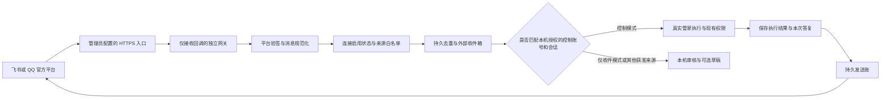

# 外部机器人接入如意与管家

设计日期：2026-10-17。基线：`eb9203fe`，实施分支 `codex/steward-3x-implementation`，当前应用版本 3.0.1。本文是 [62 号方案](62-steward-3x-iterations.md) 的新增专项；本批实施状态与验收证据在文末单独登记，不把规划当作已交付。

## 产品目标与范围

用户在飞书或 QQ 给机器人交代事情，**直接远程控制如意管家办理，并在原会话收到答复**：交办任务、续办、查询进度和结果、停止指定执行。本批的退出条件必须包含真实执行与原会话回复，仅收件或转草稿不能代表本需求完成。任务、权限、模型、执行身份、交付与故障信息都复用现有如意能力。

本产品是单用户本地工作台，首版提供“绑定本人账号，远程控制同一个管家”，与本机共享管家上下文及现有任务权限。本机用户通过管理界面显式启用控制模式，绑定一个平台发送者和一个会话；支持私聊，也支持明确选定的群聊。群内只有这个账号 @ 机器人才能控制，且回复会被群成员看到。多人共享机器人、各自私有工作区和多租户权限不包含在首版。

用户仍可完全离线使用如意。外部通道默认关闭，联网及平台账户是对应通道的可选条件。需要模型时继续使用如意已配置的服务商，包括 DeepSeek、Qwen；不要求另装本地模型，也不为接入机器人新增模型判断调用。

首批选择飞书应用机器人和 QQ 官方机器人。飞书群自定义机器人 Webhook 主要用于向群投递，不能等同于可收用户消息的应用机器人。QQ 官方应用接入与个人 QQ 的非官方协议桥不是同一种能力；OneBot 等桥接作为后续独立适配候选，不在本批默认引入。

## 现状与设计依据

- `13h-steward-runner.js` 的 `/api/steward/message`、`13q-steward-runner-turn.js` 共用管家会话与本机用户执行语义，不能直接转发外部回调到这些入口。现有递话还能触及任务和待决回答，平台身份验证不等于获得本机用户全部权限。
- `13i-steward-inbox.js` 是任务状态变化的收件箱，不是外部聊天消息箱。新入口单独收件，避免被现有自动管家循环消费。
- `13l-steward-ops.js` 的通知复用事件总线和页面展示，当前没有平台发送账本；“收到回调”“已入箱”“任务完成”“平台已接收回复”必须分别记账。
- [65 号执行身份](65-steward-execution-identity-global-health.md) 是后续远程停止等操作的前提。外部按钮也必须绑定进程、运行及待决身份，不能只凭一个 sessionId 操作当前运行。
- 后端保持零 npm 运行时依赖、Windows 一等支持。新增小型持久状态复用 `DurableJsonStore`；鉴权、收件幂等必须严格读、写成功才确认，不用失败写入留下的缓存冒充已提交事实。

## 分批交付与退出条件

| 批次 | 用户可感知结果 | 退出条件 |
|---|---|---|
| A：本人远程控制闭环（本批） | 绑定 QQ/飞书本人账号；外部自然语言直接进入管家，交办、续办、查进度/结果、停止；本次答复返回原会话 | 生产 HTTP 验签→持久受理→真实管家工具执行→官方发送协议的隔离闭环通过；持久去重、撤权、未知结果与真实页面旅程通过 |
| B：真平台体验与可靠投递 | 专用测试应用真实联调；补可靠出箱管理、收件归档、超长交付及平台系统回执语言配置；评估飞书长连接 | 平台权限、HTTPS、真实收发与重启/限流场景过门；未知执行不重跑，未知发送不盲重发 |
| C：进度订阅与远程待决 | 在平台允许的通道订阅任务进展、完成和待决提醒；在聊天中处理绑定的确认或回答 | 先核查平台主动发送能力；运行身份和待决 CAS、一次性按钮、失效/越权/回包丢失场景通过；权限提升、危险操作的确认语义与现有如意一致 |
| D：材料与更多平台 | 图片、文件受控转入附件管线；飞书长连接接入；评估企业微信、钉钉及其他桥 | 下载限额、可信地址、病毒/内容处理边界、附件生命周期与交付范围通过；新增适配不影响离线核心 |

各批可独立发布，不预先承诺版本号或日期。A 已包含本人主体绑定、管家执行和文本回发；B 才是实际账户部署联调与投递体验扩展。C/D 不因 A 的测试通过而自动标成可用。需要审批时必须如实返回待处理状态，不能提升到 bypass 或把未执行动作说成完成。62 号同名消歧、附件续办仍保留原优先级，外部接入复用其成果。

## 本批 A 的具体设计

### 消息路径

回调先持久化受理并快速确认，随后由单个事件驱动 worker 执行控制指令，不让平台的回调超时直接成为执行重试。本人控制消息按经过验证的远程指令进入管家；其他来源只入箱，其正文不能声明自己是机主或携带权限、路由参数。仅收件模式继续可选，也可由本机核对后加入草稿。HTTP 确认、已读、管家执行结果和平台发送结果是四种不同事实。

### 连接、身份与秘密

一个连接包含 `id / platform / label / enabled / appId / tenantId / botUserId`、发送者白名单和会话白名单，以及 `mode: inbox | control`。默认禁用、默认仅收件；两张白名单必须同时精确命中，不支持 `*` 或“所有群成员”。控制模式另有 `ownerSenderId / ownerConversationId / ownerConversationType`，仅该精确组合代表本机用户。控制授权只能经本机管理 token 和显式确认设置，不能由外部消息自助获取。ID 不截断后用于鉴权，不按昵称识别，不跨平台合并同名身份。

连接的平台、应用、租户和机器人身份创建后固定，换应用使用新连接 ID；名称、凭据引用、白名单与启停可以更新。删除保留 ID 墓碑和历史收件，旧 ID 不可复用；墓碑上限 4096，达到上限明确拒绝相关操作，不通过清除墓碑恢复旧身份。

飞书使用应用与租户身份、发送者 open_id、chat_id；群消息还要确实 @ 当前机器人。QQ 使用官方应用身份及消息类型对应的用户/群标识，不能把群成员 openid 当成另一个场景的通用账户 ID。

本批凭据只配置 `RUYI_BOT_` 前缀环境变量的引用名，例如 `verificationTokenEnv / encryptKeyEnv / botSecretEnv / appSecretEnv`；实际值只在进程内用于验签或官方发送鉴权。飞书发送需 App Secret，不能拿 Encrypt Key 替代；QQ 发送使用官方 Bot Secret 交换访问令牌。管理接口仅返回引用名和是否已配置，不返回秘密。不把 secret 放入 URL、正文、日志、模型上下文、版本库或迁移导出。首批管理员需在启动如意前配置进程环境；后续可接系统凭据存储。

### 协议边界

飞书处理 v2 `im.message.receive_v1` 纯文本事件：原始请求字节参与 SHA-256 校验，支持 Encrypt Key 加密信封，核验 Verification Token、应用和租户。机器人自己发出的消息、未 @ 当前机器人的群消息、未支持媒体不转换为执行文本。

QQ 处理 `C2C_MESSAGE_CREATE / GROUP_AT_MESSAGE_CREATE` 文本事件，以 Bot Secret 派生 Ed25519 密钥验证原始时间戳与请求体；应用头必须匹配配置。消息事件要求签名时间在允许窗口内。

地址验证 challenge 单独处理：它不是消息，不能入箱或执行。依官方协议允许没有事件签名头的初始化请求，但必须按平台核验应用/验证 token、解密等挑战条件；若携带签名头，部分或无效签名不能借 challenge 绕过。QQ 返回对规定挑战串的签名；飞书返回 challenge。精确条件以本批实现和测试记录为准，真平台联调之前不宣称已验证所有账户配置。

### 持久化和恢复

连接与收件放在同一个有界原子快照 `external-bots/state-v1.json`。配置修改、禁用、验签后的入箱、已读标记共享写链，防止已禁用连接的旧读结果迟到入箱。空安装读不建目录，未配置不启动网络连接或轮询器。

幂等键使用连接、租户、会话和平台 `messageId`，不能只用投递 `eventId`；同一消息换 eventId 重试也只留一条。同 key 若发送者或内容不同则拒绝冲突，不覆盖旧条目。入箱成功写盘后才向平台确认；损坏、未知 schema、读写失败明确返回失败，不把账本当空继续接收。重启后保留去重证据。

控制行另记执行状态和发送状态。`queued` 受理写成功后才确认回调；`running` 写成功后才进入管家。正常返回写 `completed/failed` 和本次答复；发送前写 `sending`，官方接口明确成功才写 `sent`。`completed` 只表示管家本轮处理结束，不等于子任务完成；`sent` 只表示平台 API 明确接收，不代表对方已读。进程重启时，旧 `running` 与 `sending` 归为 `unknown`，不能自动重跑或重发；仍为 `queued` 的条目可在复核当前授权后恢复，因为其尚未越过执行前持久门。回合异常或写结果失败保留不确定性，并提示先查询实际任务，不建议重复下令。

控制授权由私有进程内 capability 关联真实持久收件行，不能从 `/api/steward/message` 请求体或模型文本伪造。runner 入口、排队结束及每次新工具/动作开始前复核连接授权版本；停用或换绑定后，尚未开始的指令和后续工具不再获准。已经进入执行的工具或已启动子任务不承诺自动回滚，停止仍沿 65 号执行身份办理。

出站只使用已验证的原消息、发送者和会话，固定官方 API 域名。QQ 以原 `msg_id` 和固定一次回复序号回发，飞书 reply 使用原 messageId 和稳定 uuid。首版单条有界文字，超长明确说明截短；平台返回失败、请求超时和未知结果分别记录，不自动重复发送。用户可继续询问任务进度和交付。QQ 官方当前说明主动推送已停止提供，被动回复单聊有效期 60 分钟、群聊 5 分钟，每条原消息最多回复 5 次；因此 C 批不能承诺 QQ 任意时点主动通知，需保留用户新消息查询或选择平台允许的其他通道。

初始上限：16 个连接、1000 条消息；单条正文 8192 字符且 UTF-8 不超过 32 KiB，回调体 64 KiB，状态快照上限 40 MiB。满容量拒绝新消息，不能为腾位置悄悄丢弃待办或去重证据；已读也不自动删除。该容量策略适用于首批有界试用，B 批前须补保留期、归档、删除与重放窗口的一致性设计。

### 本机 API 与部署

| 接口 | 权限与含义 |
|---|---|
| `GET /api/external-bots/connections` | 本机 token；连接列表与配置就绪度 |
| `POST /api/external-bots/connections` | 本机 token；`upsert / disable / delete`，配置和收件共享串行边界 |
| `GET /api/external-bots/inbox` | 本机 token；有界分页、来源筛选、正文与接收/已读事实 |
| `POST /api/external-bots/inbox/read` | 本机 token；只标记指定本地 itemId 已读 |
| `POST /api/external-bots/callback/feishu?connectionId=…` | 仅平台回调认证；精确路径，不能访问管理能力 |
| `POST /api/external-bots/callback/qq?connectionId=…` | 同上，独立 QQ 验签 |

如意主服务继续监听回环地址。独立网关仅转发这两个 POST 回调端点，固定回环上游、保持原始字节、限制体积和超时；不得代理 bootstrap、页面、配置和其他 API，不转发浏览器 cookie、工作台 token 或任意客户端授权头。不自动创建公网隧道、修改防火墙或部署 TLS。实际平台联调需要管理员配置 HTTPS 入口，只通往该网关；不能把整站反向代理到公网。

飞书长连接适合没有公网回调入口的个人使用，但官方 SDK 不能直接成为零依赖 `server.js` 的运行时依赖。后续以可选独立连接进程实现，与网关共享规范化事件与收件契约；本批不临时复刻长连接的完整二进制协议。

### 界面

在现有管家设置中增加“外部机器人”，使用现有紧凑列表、表单和主题。可选“仅收件”或“远程控制”；启用控制时确认本人账号、目标会话、共享管家上下文及群内回复可见范围。连接状态说清楚“未启用 / 凭据未配置 / 本地配置就绪”，不能仅凭配置称“平台已连接”。收件列出平台、来源、时间、执行结果和发送结果；正文按文本显示。

“加入管家草稿”只填输入框，之后由用户手动发送；已有草稿、附件或显式目标时拒绝覆盖。清除旧自动预路由并保护迟到预判。读失败保留上次成功内容并提示刷新失败；换连接、关面板、服务换进程后的旧回包不能改写新视图。不增加定时轮询。

## 本批执行契约及后续扩展边界

1. **可验证的机主主体。** 本批使用显式 `external-owner` 来源，绑定由本机用户确认，传遍管家回合和工具动作。授权账号代表同一机主，可以访问该管家的现有上下文与任务；这是明确选定的控制范围。不能因收到普通外部文本就冒充 `trigger:user`，也不提升现有权限档。多人/多租户隔离须另行设计后才开放。
2. **会话与任务绑定。** 键包含平台、连接、租户、会话与发送者；群中其他成员不会获得控制权。任务沿现有管家路由创建和续办，标题相同不等于同一个任务；需要消歧时先返回澄清。
3. **可靠出箱。** 本批状态区分准备、已提交、平台已接收、失败、未知。依据平台消息 ID 记回执；发送超时不能无限重发，也不能把任务再次执行。只回原绑定目标，不接受消息正文里的任意 Webhook URL；人工重试、分片和保留期管理列 B 批。
4. **内容范围。** 回发本次管家的用户可见答复，限制文字长度，不直接转发工具原始输出或隐藏 reasoning，也不发送附件。它属于同一机主的远程入口，答复可能包含现有任务信息或本机路径；群聊绑定确认必须说明群内可见，不宣称首版已实现自动敏感内容脱敏。接入凭据不进入模型上下文。文件交付需独立授权和附件校验。回执不能把未发生的执行写成成功。
5. **动作身份。** 停止使用 65 号执行身份；待决使用 pendingId、版本与一次性动作令牌。换运行、撤权、进程重启、群成员变化或令牌过期必须失败关闭。平台按钮点击本身不授予永久权限。
6. **网络与故障。** 连接读取、worker 故障和投递失败在外部机器人面板独立展示，不改变任务五态；本机原有管家全局故障提示继续处理其自身请求。发送超时、限流、取消和重启恢复有界；平台离线不能阻断如意本地办理。

## 验收计划

协议：独立签名/加密夹具和 QQ 官方公开向量；挑战兼容、坏签名、原始字节篡改、错应用/租户、过期/未来时间、非人类发送者、错误 @、媒体、畸形/超限/无效 UTF-8。

服务：真实 HTTP 管理鉴权、只回调例外、默认禁用零副作用、两个白名单及控制 owner 均核验、并发重发、同消息不同事件 ID、冲突、重启持久去重、读写失败不确认、满箱拒收、重配/禁用竞态、敏感值不回显。仅收件模式不得触发模型/任务/外发；控制模式必须经生产管家回合及真实工具路径，不以 echo 或手工写任务夹具代替。

执行与回发：fake provider 驱动真实管家工具新建、查询、续办和停止，检查生产 session、回执与执行身份；仅在测试端将固定官方域的网络请求导向假平台。检查原目标/原消息关联、真实发送成功判据、重复输入只执行一次、执行前写失败零工具调用、撤权和重启 unknown 不重复执行、发送超时不重发、不重跑。

网关：只允许两条精确回调，拒绝路径编码绕行、任意上游、管理/静态/引导端点；无凭据透传；保留签名字节、超时和限额成立。

页面：配置本人控制绑定并确认→真实服务收到远程消息→显示执行与平台回复事实；仅收件模式另验加入草稿、已有草稿/附件/目标保护。外部 HTML 不执行，错误保留、刷新乱序、关闭/换进程保护；中文/英文、明暗主题、1440/768/390 宽度检查与截图。

离线通过证明生产代码处理了受控协议事件，不证明公网 HTTPS、账户审核、平台权限或真实收发已联调。真平台验证使用专用测试机器人和指定会话，不向未授权会话发测试消息；凭据不要求用户在聊天中粘贴。

## 官方参考与核查边界

核查日期 2026-10-17。协议和账户能力在真平台联调时再次核对。

- [QQ 启动接入](https://bot.q.qq.com/wiki/develop/api-v2/)：官方应用票据、账户接入。
- [QQ 事件订阅与通知](https://bot.q.qq.com/wiki/develop/api-v2/dev-prepare/interface-framework/event-emit.html)：HTTPS 回调、challenge 与事件信封。
- [QQ 安全和授权](https://bot.q.qq.com/wiki/develop/api-v2/dev-prepare/interface-framework/sign.html)：Ed25519、原始签名串与公开测试向量。
- [QQ 接口调用与鉴权](https://bot.q.qq.com/wiki/develop/api-v2/dev-prepare/interface-framework/api-use.html)、[官方发送消息文档](https://github.com/tencent-connect/bot-docs/blob/main/docs/develop/api-v2/server-inter/message/send-receive/send.md)：访问令牌、原消息回复与时效／频次限制。2026-10-17 核查到该页已标明主动推送自 2025-04-21 起不再提供；不能沿用同页未清理的旧主动消息配额作为可用能力。
- [飞书接收消息事件](https://open.feishu.cn/document/server-docs/im-v1/message/events/receive)、[事件处理](https://open.feishu.cn/document/server-side-sdk/nodejs-sdk/handling-events)、[事件订阅方式](https://open.feishu.cn/document/server-docs/event-subscription-guide/event-subscription-configure-/request-url-configuration-case)、[群自定义机器人](https://open.feishu.cn/document/client-docs/bot-v3/add-custom-bot)：官方规范入口。文档部分页面为动态渲染，搜索摘要不作为完整协议已核验的证明；协议实现须结合官方公开 SDK 的协议说明与受控向量核验，独立原创，不复制其实现。

## 本批实施与验收记录

2026-10-17：**A 批源码与隔离验收完成，尚未发布安装包，尚未完成真实平台联调。** 三个 6.1-sol 子 agent 分别实现协议/网关、后端/行为测试、前端/浏览器测试；主 agent 负责方案、独立审查、验收和文档。交付包含本人远程控制、真实管家工具执行、原消息文本回发、撤权与持久恢复，不能把此结论理解成仅收件完成。

| 验收 | 最终结果与覆盖范围 |
|---|---|
| 全量单测 | 1975 项：1949 通过、26 跳过、0 失败；跳过项不计作通过 |
| 全量静态 e2e | 主 agent 在代码冻结、登记新增文件后串行独立复跑，80/80 通过 |
| 真实 HTTP 收件 | 主 agent 独立复跑 `external-bots.e2e.js`，43 条断言通过；鉴权、签名、限额、持久去重、冲突、存储故障与仅收件零执行 |
| 真实远程控制 | 主 agent 独立复跑 `external-bots-control.e2e.js`，20 条断言通过；真实新建、查询、续办、65 号身份停止、QQ/飞书原消息回发、撤权、丢失回复、丢失回调确认和完成写盘失败后重启不重跑 |
| 网关与发送适配 | 主 agent 独立复跑 `external-bot-gateway.e2e.js` 43 条、`external-channel-delivery.e2e.js` 49 条断言通过；固定上游/官方域、签名字节、取消、失败与未知发送 |
| 真实页面 | 主 agent 独立复跑 `external-bots.browser.e2e.js`，57 条断言通过；真实授权确认、生产 worker 与管家工具、回话同步、草稿保护、注入文本不执行；中英文×明暗×1440/768/390 共 12 组合及 2 张控制表单截图通过检查 |
| 既有回归 | `steward-runner.e2e.js`、`durable-json-store.e2e.js`、`auth-deny-default.e2e.js` 独立复验通过；后者首遍在允许读取角色接口处超时，未改代码复跑通过，不能宣称首遍通过或已定位根因 |
| 构建与分发契约 | 生产构建与源码一致；模块依赖、路由鉴权、持久状态、架构快照、事实清册、语言镜像、样式令牌、覆盖更新载荷和 EOL 门禁通过；独立网关已纳入离线包复制与覆盖更新清单 |

测试使用隔离 HOME/APPDATA、合成平台凭据、确定性 fake provider 与固定官方域的本地传输替身，调用生产 HTTP、持久存储、管家和任务工具，未联系真实 QQ/飞书账户，也未发送真实消息。浏览器主验收目录为 `%TEMP%/ruyi-external-bots-shots-1792210201368`；主验收日志使用 `%TEMP%/ruyi-66-*-independent.log`，单测结果见 `%TEMP%/ruyi-66-fast-primary.log`。这些本机临时证据不随 Git 分发，可用上述测试入口重现。

收口过程发现并修复了语言镜像、清册/载荷登记、样式令牌与旧静态契约；没有关闭门禁。首遍全量静态为 66 通过、14 失败，最终独立复验为 80/80。前一遍单测中的端口碰撞经夹具动态端口修复并复验，全量最终为零失败。一次浏览器 CDP 中断来自并行启动总测试器的全局浏览器清理，之后改为串行并完整复跑；不把这次中断当成产品通过证据。新增文件已纳入 EOL 检查。

后续优先推进 B 批：专用 QQ/飞书测试应用的真实授权与 HTTPS 联调、明确平台限流及被动回复时效、设计满箱归档/保留期和人工投递管理，再推进 C 的待决身份与平台允许的进度通知。当前无自动重试、附件收发、飞书长连接或任意时点 QQ 主动通知；系统兜底回执暂为中文。独立网关需要管理员部署 HTTPS 入口，本次未创建公网隧道、部署网关或构建发布安装包。

协议核查不利证据：QQ “安全和授权”页显示的 `1725442341`、示例原始 JSON 与 `865ad…002` 签名组合，在子 agent 和主 agent 分别用 Node 内建 Ed25519 验证时均未通过；同一秘密派生的 32 字节公钥逐字符合该页公布值，独立签名可验证。首轮 18 项协议单测中因此有 1 项失败。此处不猜测平台内部原始字节，也不放宽验签；改为分别锁定公开公钥、可复现的官方 challenge 正向向量，以及该显示组合确实被拒绝。不能据此宣称所有官方签名样例都通过，真实平台联调仍是后续独立验收项。
